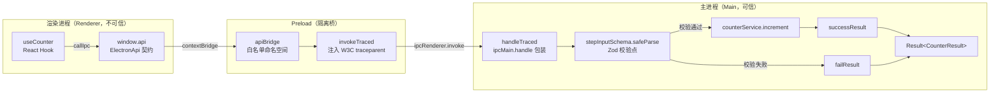

---

title: 类型安全的 IPC 契约（Zod + ContextBridge）
description: 通道、入参与返回值在 @app/shared 统一定义，Zod 边界强校验，Preload 白名单暴露。
---

# 类型安全的 IPC 契约（Zod + ContextBridge）

> **TL;DR**：通信通道、入参校验与统一响应结构全部收敛在 `@app/shared`；Zod Schema 在主进程 Controller 边界执行 `safeParse`，Preload 只通过 `contextBridge` 暴露白名单 `apiBridge` 与只写日志的 `loggerBridge`，绝不向渲染端泄露原生 `ipcRenderer`。

## 1. 选型理由

Electron 默认的 IPC 通信缺少端到端约束：
1. **字符串硬编码**：通道名手拼字符串，改动一处容易漏改且无编译报错。
2. **脏数据直插业务**：渲染层传来的未校验数据直接进入后端 Service，容易触发运行时异常。
3. **安全边界失守**：若 Preload 直接挂载原生 `ipcRenderer`，前端脚本可任意探测并调用内部通道。

工程通过「`@app/shared` 单一事实源 + Preload 白名单转发 + Controller Zod 校验 + `Result<T>` 互斥响应」实现编译期与运行期双保险。

→ 官方文档：[Electron contextBridge](https://www.electronjs.org/docs/latest/api/context-bridge)（读它能了解隔离上下文通信原理、结构化克隆边界与只读代理限制；入参校验由仓库 `zod` Schema 配合 `z.infer` 完成）。

## 2. 核心机制

一次 `counter.increment` 调用穿过三层信任边界：Renderer 只持有 `window.api` 的 `ElectronApi` 契约；Preload 用 `apiBridge` 收窄可调用面，并由 `invokeTraced` 注入 `traceparent`；Main 在 `handleTraced` 包装的 Controller 入口用 Zod 校验，通过后才进入 Service，最终以 `Result<T>` 互斥返回。



### 契约集中收拢（单一事实源）

通道常量统一收拢在 [ipc-channels.ts](https://github.com/BanShan-Alec/electron-react-monorepo-template/blob/main/packages/shared/src/constants/ipc-channels.ts) 的 `IPC_CHANNELS`，`window.api` 接口定义在 [api.ts](https://github.com/BanShan-Alec/electron-react-monorepo-template/blob/main/packages/shared/src/types/api.ts) 的 `ElectronApi`；所有请求-响应通道统一返回 `Result<T>` 互斥联合：

→ 源码：[packages/shared/src/types/result.ts](https://github.com/BanShan-Alec/electron-react-monorepo-template/blob/main/packages/shared/src/types/result.ts)

```ts
export type Result<T> =
  | { success: true; data: T; traceId?: string }
  | { success: false; error: string; code?: string; traceId?: string };
```

### Controller 边界 Zod 校验

主进程 Controller 在 `handleTraced` 入口将入参标为 `unknown`，经 `safeParse` 校验通过后才解构数据交给纯业务 Service：

→ 源码：[packages/main/src/controllers/counter.controller.ts](https://github.com/BanShan-Alec/electron-react-monorepo-template/blob/main/packages/main/src/controllers/counter.controller.ts)

```ts
// 节选：registerCounterControllers 中 COUNTER_INCREMENT 的边界校验
handleTraced(
  IPC_CHANNELS.COUNTER_INCREMENT,
  async (_event, rawInput: unknown): Promise<Result<CounterResult>> => {
    const parseResult = stepInputSchema.safeParse(rawInput ?? {});
    if (!parseResult.success) {
      return failResult(parseResult.error.issues[0].message, ErrorCode.VALIDATION_ERROR);
    }
    try {
      return successResult(counterService.increment(parseResult.data.step));
    } catch (err) {
      return catchToResult(err);
    }
  },
);
```

### Preload 白名单隔离代理

Preload 只把收窄后的 `apiBridge` 与只写日志桥 `loggerBridge` 挂载到 `window`，业务方法全部走 `invokeTraced`：

→ 源码：[packages/preload/src/index.ts](https://github.com/BanShan-Alec/electron-react-monorepo-template/blob/main/packages/preload/src/index.ts)

```ts
  // 节选：apiBridge.counter 命名空间与 contextBridge 暴露入口
  counter: {
    get: (_payload, options) => invokeTraced(IPC_CHANNELS.COUNTER_GET, undefined, options),
    increment: (input: StepInput | undefined, options?: IpcCallOptions) =>
      invokeTraced(IPC_CHANNELS.COUNTER_INCREMENT, input, options),
    decrement: (input: StepInput | undefined, options?: IpcCallOptions) =>
      invokeTraced(IPC_CHANNELS.COUNTER_DECREMENT, input, options),
    reset: (_payload, options) => invokeTraced(IPC_CHANNELS.COUNTER_RESET, undefined, options),
  },
// ... 其余业务命名空间同构
contextBridge.exposeInMainWorld('api', apiBridge);
contextBridge.exposeInMainWorld('logger', loggerBridge);
```

## 3. 桌面端避坑注意事项

- **入参类型由 `z.infer` 自动推导**：
  - TypeScript 类型直接从 Zod Schema 派生（如 `StepInput`），不在 `types/` 中手工抄写第二份接口，防止编译类型与运行时校验漂移。
- **校验必须发生在 Controller 边界**：
  - Service 只接收通过校验的数据，保持无 Electron/IPC 耦合，便于 Node 环境下直接做纯单元测试（详见 [分层架构](/architecture/layering)）。
- **严禁暴露原始 `ipcRenderer` 或绕过 `Result<T>`**：
  - 禁止 `exposeInMainWorld('ipcRenderer', ipcRenderer)`；所有请求-响应通道统一经 `invokeTraced` 与 `handleTraced` 返回 `Promise<Result<T>>`（`DIAGNOSTICS_LOG` 作为静默日志管道除外，详见 [本地日志](/main/logging) 与 [全链路追踪](/main/tracing)）。
- **页面职责边界**：
  - **本页负责**：`@app/shared` 跨端契约、Preload `contextBridge` 白名单转发与 Controller 边界 Zod 校验。
  - **本页不负责**：W3C `traceparent` 传播与 `AsyncLocalStorage` 细节见 [全链路追踪](/main/tracing)；进程沙箱参数见 [渲染进程沙箱](/security/sandbox)；新增跨端功能四步流水线见 [全栈端到端功能开发](/ai/fullstack-sop)。
