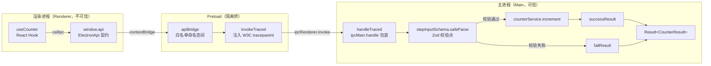

---

title: 类型安全的 IPC 契约（Zod + ContextBridge）
description: 通道、入参与返回值在 @app/shared 统一定义，Zod 强校验，Preload 白名单暴露。
---

# 类型安全的 IPC 契约（Zod + ContextBridge）

> **TL;DR**：通信通道、入参校验与统一响应结构全部收敛在 `@app/shared`；Zod Schema 在主进程 Controller 边界执行强校验，Preload 只通过 `contextBridge` 暴露白名单 `apiBridge` 与只写日志的 `logger` 桥，绝不向渲染端泄露原生 `ipcRenderer`。

## 1. 选型理由

Electron 默认的 IPC 通信极其松散且危险：
1. **字符串硬编码**：通道名称手拼字符串，一处改动引发全局连带断裂且无编译报错。
2. **脏数据直插业务**：渲染层发来的非法数据未经验证直接传递给后端 Service，极易引发运行时异常。
3. **安全边界失守**：若在 Preload 中直接挂载 `ipcRenderer.invoke`，恶意前端脚本可随意嗅探并调用任意内部系统通道。

工程通过强契约与类型安全管道，实现编译期有约束、运行期有拦截。

## 2. 核心机制

一次 `counter.increment` 调用要穿过三层信任边界：Renderer 只持有 `window.api` 的类型契约；Preload 用 `apiBridge` 收窄可调用面，并由 `invokeTraced` 统一注入 traceparent；Main 在 `handleTraced` 包装的 Controller 入口用 Zod 校验，通过后才进入 Service，最终以 `Result<T>` 互斥返回。



### 关键实现

#### 契约集中收拢（单一事实源）

→ 源码：[packages/shared/src/constants/ipc-channels.ts](https://github.com/BanShan-Alec/electron-react-monorepo-template/blob/main/packages/shared/src/constants/ipc-channels.ts)

节选：仅展示 4 条通道，完整清单见源码：

```ts
export const IPC_CHANNELS = {
  SYSTEM_PING: 'system:ping',
  COUNTER_GET: 'counter:get',
  COUNTER_INCREMENT: 'counter:increment',
  CONFIG_GET: 'config:get',
} as const;

export type IpcChannel = (typeof IPC_CHANNELS)[keyof typeof IPC_CHANNELS];
```

统一响应结构 `Result<T>` 保证成功与失败互斥：

→ 源码：[packages/shared/src/types/result.ts](https://github.com/BanShan-Alec/electron-react-monorepo-template/blob/main/packages/shared/src/types/result.ts)

```ts
export type Result<T> =
  | { success: true; data: T; traceId?: string }
  | { success: false; error: string; code?: string; traceId?: string };
```

#### Controller 边界 Zod 校验

主进程 Controller 在入口处将参数类型标为 `unknown`，经 Schema 验证后才递交 Service：

→ 源码：[packages/main/src/controllers/counter.controller.ts](https://github.com/BanShan-Alec/electron-react-monorepo-template/blob/main/packages/main/src/controllers/counter.controller.ts)

节选：仅展示 `COUNTER_INCREMENT` 的注册，其余控制器同构（省略）：

```ts
export function registerCounterControllers(): void {
  handleTraced(
    IPC_CHANNELS.COUNTER_INCREMENT,
    async (_event, rawInput: unknown): Promise<Result<CounterResult>> => {
      const parseResult = stepInputSchema.safeParse(rawInput ?? {});
      if (!parseResult.success) {
        return failResult(parseResult.error.issues[0].message, ErrorCode.VALIDATION_ERROR);
      }
      try {
        return successResult(counterService.increment(parseResult.data.step));
      } catch (err) {
        return catchToResult(err);
      }
    },
  );
}
```

#### Preload 白名单隔离代理

节选：`apiBridge` 的 `counter` 命名空间，其余业务命名空间同构：

→ 源码：[packages/preload/src/index.ts](https://github.com/BanShan-Alec/electron-react-monorepo-template/blob/main/packages/preload/src/index.ts)

```ts
export const apiBridge: ElectronApi = {
  counter: {
    get: (options) => invokeTraced(IPC_CHANNELS.COUNTER_GET, undefined, options),
    increment: (input: StepInput | undefined, options?: IpcCallOptions) =>
      invokeTraced(IPC_CHANNELS.COUNTER_INCREMENT, input, options),
    decrement: (input: StepInput | undefined, options?: IpcCallOptions) =>
      invokeTraced(IPC_CHANNELS.COUNTER_DECREMENT, input, options),
    reset: (options) => invokeTraced(IPC_CHANNELS.COUNTER_RESET, undefined, options),
  },
};

contextBridge.exposeInMainWorld('api', apiBridge);
```

## 3. 桌面端避坑注意事项

- **入参类型由 `z.infer` 自动推导**：
  - TypeScript 类型直接从 Zod Schema 派生，全仓杜绝手动抄写第二份 `interface StepInput`，避免类型与校验规则长期不同步。
- **校验必须发生在 Controller 边界**：
  - Service 只接收通过校验的干净数据。若将校验逻辑塞入 Service，会导致纯业务逻辑充满防御性判断，丧失在 Node 环境下的单测纯粹性。
- **严禁向渲染层暴露原始 `ipcRenderer`**：
  - 无论何时，切勿为了图方便在 Preload 中书写 `exposeInMainWorld('ipcRenderer', ipcRenderer)`，这等同于向外部攻击者大开任意 IPC 调用的后门。
