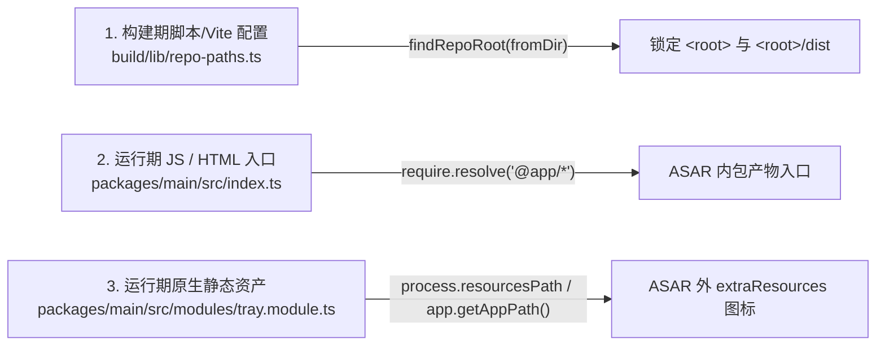

---

title: 路径稳健性（Relative-path）
description: 分层锚定构建期仓库根、运行期包入口与打包态原生资源，彻底规避 process.cwd() 偏移。
---

# 路径稳健性（Relative-path）

> **TL;DR**：构建期通过 `findRepoRoot` 从脚本物理位置向上锚定仓库根；运行期 JS/HTML 入口沿 `require.resolve` 包图解析；托盘等原生资源优先读取 `process.resourcesPath/buildResources`，三层均不依赖 `process.cwd()`。

## 1. 选型理由

桌面客户端的启动工作目录与普通后端服务有本质差异：
- **快捷方式与自启拉起的工作目录偏移**：用户双击桌面快捷方式、系统开机自启或通过文件关联打开时，`process.cwd()` 往往落在 `C:\Windows\System32`、用户桌面或 `/` 目录。
- **相对路径与目录深度耦合断裂**：构建脚本写死 `../..` 或运行时写 `./resources/icon.png`，一旦移动脚本层级或从快捷方式启动就会触发资源 404。

工程确立「自身位置锚定」原则：构建期看文件物理位置，运行期看 Node 模块图与 Electron 资源锚点。

→ 官方文档：[Electron process.resourcesPath](https://www.electronjs.org/docs/latest/api/process#processresourcespath-readonly)（读它能了解打包前后 `process.resourcesPath` 与 `app.getAppPath()` 的指向差异及 ASAR 外置资源的寻址规则）。

## 2. 核心机制（三层职责边界）



### 第一层：构建期向上探测仓库根（`findRepoRoot`）

全仓脚本与 Vite 配置统一传入 `import.meta.dirname`（ESM）或 `__dirname` 调用 `findRepoRoot`，向上查找同时包含 `package.json` 与 `pnpm-workspace.yaml` 的目录，与调用方所在子目录深度无关：

→ 源码：[build/lib/repo-paths.ts](https://github.com/BanShan-Alec/electron-react-monorepo-template/blob/main/build/lib/repo-paths.ts)

```ts
// 节选：findRepoRoot 从物理目录向上递归定位 Monorepo 根目录
export function findRepoRoot(fromDir: string): string {
  let current = path.resolve(fromDir);
  while (true) {
    if (
      fs.existsSync(path.join(current, 'package.json')) &&
      fs.existsSync(path.join(current, 'pnpm-workspace.yaml'))
    ) {
      return current;
    }
    const parent = path.dirname(current);
    if (parent === current) {
      throw new Error(`[repo-paths] 无法从 ${fromDir} 向上定位仓库根目录`);
    }
    current = parent;
  }
}
```

### 第二层：运行期包入口解析（`require.resolve`）

主进程在生产态加载渲染入口与 Preload 时，直接在 [packages/main/src/index.ts](https://github.com/BanShan-Alec/electron-react-monorepo-template/blob/main/packages/main/src/index.ts) 中调用 `require.resolve('@app/renderer')`、`require.resolve('@app/renderer/updater')` 与 `require.resolve('@app/preload')`，沿 Node 依赖图定位 ASAR 内的编译产物，不手拼 `dist/` 相对路径。

### 第三层：运行期原生资产定位（托盘图标）

打包时 `build/electron-builder.ts` 通过 `extraResources` 将 `build/resources` 拷贝到 ASAR 外部的 `buildResources` 目录。运行期 `TrayManager.resolveIconPath()` 优先检查 `process.resourcesPath/buildResources`（打包态），不存在时再回落 `app.getAppPath()/build/resources`（开发态）：

→ 源码：[packages/main/src/modules/tray.module.ts](https://github.com/BanShan-Alec/electron-react-monorepo-template/blob/main/packages/main/src/modules/tray.module.ts)

```ts
  // 节选：TrayManager.resolveIconPath 打包外置资源与开发态双锚点解析
  private resolveIconPath(): string {
    const isWin = process.platform === 'win32';
    const iconNames = isWin ? ['icon.ico', 'icon.png'] : ['icon.png'];

    const baseDirs: string[] = [];
    if (process.resourcesPath) {
      baseDirs.push(path.join(process.resourcesPath, 'buildResources'));
    }
    if (app) {
      baseDirs.push(path.join(app.getAppPath(), 'build', 'resources'));
    }

    for (const dir of baseDirs) {
      for (const name of iconNames) {
        const candidate = path.join(dir, name);
        if (fs.existsSync(candidate)) {
          return candidate;
        }
      }
    }
    return '';
  }
```

## 3. 桌面端避坑注意事项

- **规约定位：最佳工程指导而非机械阻断门禁**：
  - 避免依赖 `process.cwd()` 作为代码审查与工程最佳实践遵循，以规避快捷方式偏移风险；仓库不设全局静态门禁脚本阻断。
- **`import.meta.dirname` 与 `__dirname` 的环境差异**：
  - 全仓源码为 ESM，Vite 配置等直接运行场景优先使用 `import.meta.dirname`（Node >= 20 原生支持）；由构建器/执行器注入 CJS 语义的脚本中可使用 `__dirname`。
- **原生二进制与图标须置于 ASAR 外部**：
  - `.node` 原生插件通过 `asarUnpack: ['**/*.node']` 解包，托盘图标通过 `extraResources` 外置到 `process.resourcesPath/buildResources`，确保操作系统底层 API 可直接读取物理文件路径。
- **页面职责边界**：
  - **本页负责**：构建期根目录探测、运行期 `require.resolve` 模块寻址与托盘等外置原生资源锚点解析。
  - **本页不负责**：`extraResources` 与 `asarUnpack` 打包配置见 [应用打包](/delivery/packaging)；托盘菜单多语言与图标缩放策略见 [托盘常驻与单实例](/main/tray-single-instance)。
