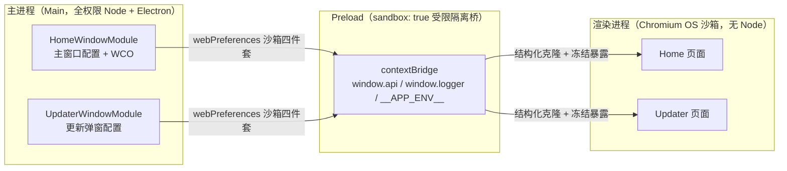

---

title: 渲染进程沙箱（Sandbox）
description: webPreferences 写死沙箱隔离四件套，主窗口与辅助弹窗各自显式声明并一视同仁。
---

# 渲染进程沙箱（Sandbox）

> **TL;DR**：所有 `BrowserWindow` 实例的 `webPreferences` 强制写死沙箱四件套（关闭 Node、开启上下文隔离、开启沙箱、禁用 Webview）；主窗口与更新弹窗各自就地声明同一组安全参数，渲染进程与操作系统完全物理隔离。

## 1. 选型理由

Electron 历史上最严重的安全漏洞多源于沙箱配置不严：
- **`nodeIntegration: true` 的 RCE 风险**：一旦页面被注入任何第三方脚本或 XSS，攻击者可直接调用 Node 原生模块获取操作系统 Shell 权限。
- **上下文未隔离**：若未开启 `contextIsolation`，页面脚本可通过重写原型链劫持 Preload 中的私有变量，绕过安全通道。

工程确立底座级安全准则：**任何窗口均作为非受信 Web 沙箱运行**，绝不因“只是轻量通知弹窗”而放松门禁。

→ 官方文档：[Electron Process Sandboxing](https://www.electronjs.org/docs/latest/tutorial/process-sandboxing)（读它能了解开启 `sandbox: true` 后渲染进程与 Preload 各自保留的能力边界及 OS 级隔离原理）。

## 2. 核心机制



### 强制写死沙箱四件套与两窗各写一份的决策

主窗口与更新窗口均在 `new BrowserWindow(...)` 调用点就地声明完全一致的安全四件套，只共享 `this.preload.path` 与 `getPackedEnvArgument()`：

→ 源码：[packages/main/src/modules/window/home-window.module.ts](https://github.com/BanShan-Alec/electron-react-monorepo-template/blob/main/packages/main/src/modules/window/home-window.module.ts) · [packages/main/src/modules/window/updater-window.module.ts](https://github.com/BanShan-Alec/electron-react-monorepo-template/blob/main/packages/main/src/modules/window/updater-window.module.ts)

```ts
      // 节选：home-window.module.ts 与 updater-window.module.ts 保持完全一致的 webPreferences
      webPreferences: {
        nodeIntegration: false,
        contextIsolation: true,
        sandbox: true,
        webviewTag: false,
        preload: this.preload.path,
        additionalArguments: [getPackedEnvArgument()],
      },
```

之所以两窗各自显式写一份 `webPreferences`，而非抽成共享工厂函数或 `baseWindowConfig`：
1. **安全边界就地可审计**：审查窗口创建代码时，无需跳转多层包装就能在 `new BrowserWindow` 原地一眼核对四项安全开关。
2. **避免窗口生命周期耦合**：主窗口需要 `windowStatePersistence`、`minWidth` 与平台 WCO 选项，更新弹窗需要 `show: false`、`frame: false` 与 `resizable: false`；只让安全四件套各自显式对齐，两类窗口其余行为互不牵连。

## 3. 桌面端避坑注意事项

- **沙箱边界决定渲染端无 Node 运行时**：
  - 由于 `nodeIntegration: false` 与 `sandbox: true`，渲染进程在运行时处于纯浏览器沙箱，不存在 `node:fs` 等原生模块；所有文件、系统对话框或进程交互都必须经由 Preload 白名单通道转发，渲染端隔离约束见根文档与 [类型安全的 IPC 契约](/security/ipc-contract)。
- **ContextBridge 传参防逃逸**：
  - 通过 `contextBridge.exposeInMainWorld` 暴露的方法，入参与返回值都会经 Chromium 底层结构化克隆。禁止向渲染层传递主进程类实例或可变系统句柄，只暴露纯函数、基础数据及 `Object.freeze` 冻结后的运行时环境快照（`window.__APP_ENV__`）。
- **沙箱环境下 Preload 的能力收敛**：
  - 开启 `sandbox: true` 后，Preload 脚本自身也无法随意加载完整 Node 模块（本仓 Preload 仅消费 `electron` 的 `contextBridge`、`ipcRenderer`、`webUtils` 与启动参数 `process.argv` / `process.platform`）。这是刻意为之的纵深防御设计，新增能力应放进主进程 Service 并通过 IPC 暴露。
- **页面职责边界**：
  - **本页负责**：`BrowserWindow` 的 `webPreferences` 沙箱四件套决策、多窗口隔离一致性与 Preload 沙箱边界。
  - **本页不负责**：Preload 白名单通道与 Zod 入参校验见 [类型安全的 IPC 契约](/security/ipc-contract)；CSP 响应头与外链拦截见 [内容安全策略](/security/csp)；多窗口入口拆分见 [多窗口入口](/architecture/multi-window)。
