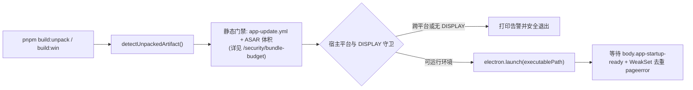

---

title: 产物冒烟测试（Dist-smoke）
description: 打包后真实拉起解包二进制产物，断言启动协调器揭幕并捕获未处理异常，跨平台或无显示服务环境显式安全跳过。
---

# 产物冒烟测试（Dist-smoke）

> **TL;DR**：`electron-builder` 构建成功不代表安装包可正常运行。`scripts/verify-postbuild.ts` 在打包后自动跨平台定位解包二进制，结合发布配置校验、Playwright 拉起真实 exe/app/binary、等待 `body.app-startup-ready` 揭幕并去重捕获 `pageerror`，将白屏与运行时崩溃拦在发版前。

> **本页职责边界**：本页负责打包后产物的跨平台发现、真实二进制启动、`body.app-startup-ready` 揭幕门禁与 `pageerror` 去重捕获；不负责 `app.asar` 体积上限（`MAX_ASAR_SIZE_MB`）与模块构成分析（见 [分包与体积门禁（Chunk + Asar）](/security/bundle-budget)）、源码态功能 E2E（见 [端到端测试（Playwright）](/testing/e2e-electron)），以及打包配置本身（见 [应用打包（Electron-builder）](/delivery/packaging)）。

## 1. 选型理由

- **打包成功不等于运行期健康**：`electron-builder` 退出码为 0 只说明资源打包结束；若原生 `.node` 模块架构错配、ASAR 路径缺失或构建期引入运行时异常，客户端会在用户侧直接白屏。
- **杜绝 `#root` 静态假阳性**：HTML 模板本身自带 `<div id="root"></div>`，即使 React 运行时报错挂死，DOM 仍存在 `#root`。必须等待 React 首帧 commit 与主进程双门禁共同解锁的 `body.app-startup-ready` 类名。
- **跨平台宿主机安全降级**：在 Linux 交叉构建 Windows 产物或无图形界面的纯命令行容器下，自动跳过二进制拉起测试并保留静态检查，避免误报失败。

## 2. 核心机制



### 跨平台探测与宿主机安全守卫

`detectUnpackedArtifact(distDir)` 统一抹平 Windows（`win-unpacked/*.exe`）、macOS（`mac*/Contents/MacOS/*`）与 Linux（`linux-unpacked/*`）路径差异。随后先完成静态门禁（`resources/app-update.yml` 存在性校验与 `app.asar` 体积门禁，后者规则见 [分包与体积门禁（Chunk + Asar）](/security/bundle-budget)），再判定当前宿主机是否能拉起目标二进制：

→ 源码：[scripts/verify-postbuild.ts](https://github.com/BanShan-Alec/electron-react-monorepo-template/blob/main/scripts/verify-postbuild.ts)

```ts
// 节选：跨平台宿主与 Linux 无显示服务环境守卫
if (process.platform !== artifact.platform) {
  console.warn(
    `⚠️ [verify-postbuild] 目标平台 (${artifact.platform}) 与当前宿主平台 (${process.platform}) 不一致，跳过真实进程启动测试。`,
  );
  return;
}

// 无显示服务环境守卫（如无 Xvfb 的 Linux 纯命令行服务器或容器）
if (process.platform === 'linux' && !process.env.DISPLAY && !process.env.WAYLAND_DISPLAY) {
  console.warn(
    '⚠️ [verify-postbuild] 检测到当前 Linux 环境无可用 DISPLAY/WAYLAND 桌面显示服务，跳过运行时进程拉起测试。',
  );
  return;
}
```

### 真实二进制启动与异常去重断言

在独立的 `tempUserDataDir` 下拉起解包产物，同时订阅 `app.on('window')` 与 `firstWindow()` 防止漏听首窗，并用 `WeakSet<Page>` 与错误指纹 `Set` 去重 `pageerror`，在 15 秒内断言 `body.app-startup-ready` 挂载成功。

→ 源码：[scripts/verify-postbuild.ts](https://github.com/BanShan-Alec/electron-react-monorepo-template/blob/main/scripts/verify-postbuild.ts)

```ts
// 节选：拉起真实打包产物，去重监听 pageerror 并等待启动协调器揭幕
const app = await electron.launch({
  executablePath: artifact.executablePath,
  args: [`--user-data-dir=${tempUserDataDir}`, '--no-sandbox', '--disable-gpu'],
  timeout: 30000,
});
const pageErrors: Error[] = [];
const errorFingerprints = new Set<string>();
const attachedPages = new WeakSet<Page>();
const attachPage = (p: Page) => {
  if (attachedPages.has(p)) return;
  attachedPages.add(p);
  p.on('pageerror', (err) => {
    const fp = `${err.name}:${err.message}\n${err.stack ?? ''}`;
    if (!errorFingerprints.has(fp)) {
      errorFingerprints.add(fp);
      pageErrors.push(err);
    }
  });
};
app.on('window', attachPage);
const page = await app.firstWindow();
attachPage(page);
await page.waitForSelector('body.app-startup-ready', { timeout: 15000 });
```

### 打包流程自动串联与独立执行

打包脚本 `scripts/build.ts` 会在构建结束后默认自动调用 `verifyPostbuild`（仅 `--skip-verify` 可跳过）；也可在已有 `dist/` 产物后单独执行 `pnpm verify:postbuild` 复验。校验在 `finally` 块中同时保证关闭 Electron 实例并清理临时 `userData` 目录。

若 `waitForSelector('body.app-startup-ready')` 超时或 `pageErrors.length > 0`，脚本立即抛出异常并以非零退出码阻断打包流。

→ 源码：[scripts/build.ts](https://github.com/BanShan-Alec/electron-react-monorepo-template/blob/main/scripts/build.ts)

```ts
// 节选：打包完成后默认串联后置冒烟验真
if (!values['skip-verify']) {
  try {
    await verifyPostbuild({ distDir: getDistDir(ROOT_DIR) });
  } catch (verifyError) {
    console.error('❌ Post-packaging verification failed:', verifyError);
    process.exit(1);
  }
}
```

- **官方文档**：[Playwright `electron.launch`](https://playwright.dev/docs/api/class-electron#electron-launch) — 读它能解决什么：理解通过 `executablePath` 直接拉起已打包原生可执行文件与传入 `--user-data-dir` 的参数机制。

## 3. 桌面端避坑注意事项

| 避坑要点                     | 事故表现与原因                                                                                | 本仓库对齐方案                                                                                      |
| :--------------------------- | :-------------------------------------------------------------------------------------------- | :-------------------------------------------------------------------------------------------------- |
| **依赖 `#root` 产生假阳性**  | React 抛全局异常导致白屏时，HTML 预置的 `#root` 节点依然存在，校验误判通过。                  | 强制等待 `body.app-startup-ready`（React 首帧与主进程双门禁就绪后注入），并检查 `pageErrors` 为空。 |
| **首窗与多窗异常重复计数**   | `app.on('window')` 错失首窗或与 `firstWindow()` 重复绑定监听，同一异常计数翻倍。              | 同时挂载 `window` 与 `firstWindow()`，并用 `WeakSet<Page>` 与指纹集合幂等去重。                     |
| **单实例锁拦截冒烟进程**     | 未传独立目录时，打包产物会激活本地已开启的开发态进程后立即退出，导致等待超时。                | 每次启动前 `fs.mkdtempSync` 建隔离目录并在 `finally` 强制删除。                                     |
| **`--skip-verify` 逃生边界** | 若发版流水线误带 `--skip-verify` 参数，将绕过 `app-update.yml`、ASAR 体积与启动冒烟全部防线。 | `--skip-verify` 仅限本地调试打包脚本使用，CI 与发版流禁止携带该参数。                               |
