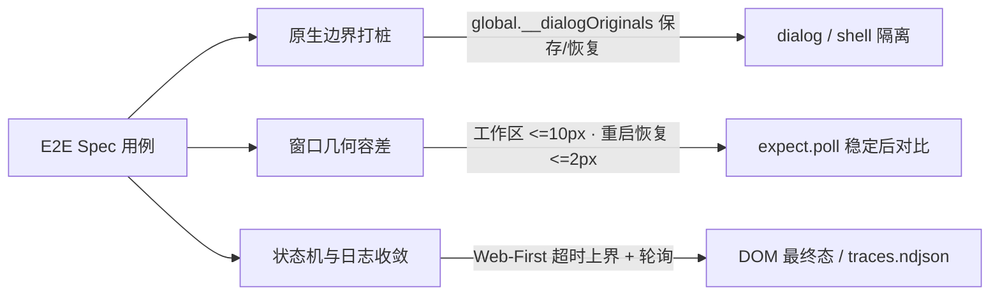

---

title: 端到端断言策略（Shell-stub + Tolerance）
description: 用例内隔离打桩原生对话框与 shell 接口并及时恢复，窗口几何保留物理容差，状态机与落盘日志只锁最终态与轮询收敛。
---

# 端到端断言策略（Shell-stub + Tolerance）

> **TL;DR**：E2E 断言严禁穿透操作系统原生 UI 或依赖脆弱的像素/毫秒级瞬时值。系统级 `shell` 启动打桩由公共启动器兜底，单个 spec 覆盖 `dialog`/`shell` 时须保存并在结束后恢复原实现；窗口几何断言保留物理舍入容差（10px / 2px）；异步状态与落盘日志使用 Web-First 断言与 `expect.poll` 收敛到最终态。

> **本页职责边界**：本页负责 E2E 测试内部的 `dialog`/`shell` 局部打桩恢复、窗口几何容差断言，以及状态机最终态与日志轮询验证策略；不负责 Playwright Worker 夹具复用、全局 `launchElectronApp` 启动桩与进程树清理机制（见 [端到端测试（Playwright）](/testing/e2e-electron)），也不负责打包后产物冒烟（见 [产物冒烟测试（Dist-smoke）](/testing/artifact-smoke)）。

## 1. 选型理由

- **防止原生阻塞与同 Worker 桩泄漏**：`dialog.showSaveDialog` 等系统原生弹窗会永久阻塞进程等待人工点击；由于全仓 E2E 共享单 Worker 实例，spec 内替换 `dialog`/`shell` 后若不恢复，会污染同进程内后续用例。
- **抹平 High-DPI 与无边框窗口舍入误差**：Windows 无边框窗口的 `getBounds()` 包含不可见 resize 边框，跨进程恢复 `getNormalBounds()` 时也存在亚像素舍入，绝对等值断言必然在 CI 随机翻红。
- **拒绝固定 `waitForTimeout` 猜时序**：CI 虚拟机 CPU 抢占会导致固定延迟偶发失效；通过锁定兜底超时上界与 `expect.poll` 轮询收敛，兼顾执行速度与稳定性。

## 2. 核心机制

所有 E2E 断言围绕一条基本原则设计：**不在测试中与操作系统抢焦点、猜耗时**。遇到原生系统接口先隔离打桩并在 `finally` 还原，遇到窗口尺寸保留平台物理容差，遇到异步状态与日志落盘统一用自动重试断言收敛。



### 原生边界局部打桩与恢复

全局 `shell` 安全桩已在 `launchElectronApp` 启动阶段统一注入（见 [端到端测试（Playwright）](/testing/e2e-electron) 与 [e2e/helpers/electron.ts](https://github.com/BanShan-Alec/electron-react-monorepo-template/blob/main/e2e/helpers/electron.ts)），防止无头 Linux 误唤起 `xdg-open` 孤儿进程。当单个测试需要进一步拦截 `dialog` 或断言 `shell.showItemInFolder` 调用参数时，必须把原引用缓存在 `globalThis` 并在 `finally` 恢复：

→ 源码：[e2e/dialog.spec.ts](https://github.com/BanShan-Alec/electron-react-monorepo-template/blob/main/e2e/dialog.spec.ts)

```ts
// 节选：保存并恢复 dialog / shell 原始实现，防止同 Worker 后续用例被污染
async function mockSaveDialog(electronApp: ElectronApplication, savePath: string) {
  await electronApp.evaluate(({ dialog, shell }, targetPath) => {
    const g = globalThis as any;
    g.__dialogOriginals ??= {};
    g.__dialogOriginals.showSaveDialog ??= dialog.showSaveDialog;
    g.__dialogOriginals.showItemInFolder ??= shell.showItemInFolder;
    g.__dialogMockCalls = { showItemInFolder: [] as string[] };

    dialog.showSaveDialog = async () => ({ canceled: false, filePath: targetPath });
    shell.showItemInFolder = (fullPath: string) => {
      g.__dialogMockCalls.showItemInFolder.push(fullPath);
    };
  }, savePath);
}

async function restoreDialogMocks(electronApp: ElectronApplication) {
  await electronApp.evaluate(({ dialog, shell }) => {
    const g = globalThis as any;
    if (g.__dialogOriginals?.showSaveDialog)
      dialog.showSaveDialog = g.__dialogOriginals.showSaveDialog;
    if (g.__dialogOriginals?.showItemInFolder)
      shell.showItemInFolder = g.__dialogOriginals.showItemInFolder;
    delete g.__dialogOriginals;
  });
}
```

### 窗口几何容差与稳定性轮询

验证窗口初始尺寸与重启恢复时，先用 `expect.poll` 等待连续两次 `getNormalBounds()` 读数一致（取代固定 `sleep`），再按平台物理边框特性校验容差——工作区自适应与 `setBounds` 校验容差 `10px`，同 `userData` 跨进程恢复容差 `2px`：

→ 源码：[e2e/window-state.spec.ts](https://github.com/BanShan-Alec/electron-react-monorepo-template/blob/main/e2e/window-state.spec.ts)

```ts
// 节选：冷启动尺寸容差 10px（含 Windows 无边框窗口不可见 resize 边框）
expect(Math.abs(bounds.width - expectedWidth)).toBeLessThanOrEqual(10);
expect(Math.abs(bounds.height - expectedHeight)).toBeLessThanOrEqual(10);

// 节选：等待原生窗口应用 bounds 并连续两次读数稳定，再跨进程验证 2px 舍入容差
await expect
  .poll(
    async () => {
      const current = await readBounds();
      const stable = previous !== null && JSON.stringify(current) === JSON.stringify(previous);
      previous = current;
      return stable;
    },
    { timeout: 5000, intervals: [150] },
  )
  .toBe(true);
// 容差 2px：跨进程恢复时 Windows 会对无边框窗口做一次舍入
for (const key of ['x', 'y', 'width', 'height'] as const) {
  expect(Math.abs(restored[key] - expected[key])).toBeLessThanOrEqual(2);
}
```

### 时序断言只锁最终态与兜底上界

动画淡入淡出节奏留给人工目测，E2E 只锁状态机最终 DOM 态与源码常量导出的兜底限时；同样地，日志与遥测落盘校验（如 `main.log`、`traces.ndjson`）也通过 `expect.poll` 等待文件写入收敛。

→ 源码：[e2e/first-screen.spec.ts](https://github.com/BanShan-Alec/electron-react-monorepo-template/blob/main/e2e/first-screen.spec.ts)

```ts
// 节选：时序断言只锁"最终态 + 兜底上界"
test('AC-1 双门禁达成：body 挂上 app-startup-ready（3000ms 兜底界内）', async ({ page }) => {
  await expect(page.locator('body')).toHaveClass(/app-startup-ready/, {
    timeout: STARTUP_REACT_FALLBACK_MS,
  });
});

test('AC-2 壳物理退场：ready 后 ≤1000ms #loading 从 DOM 移除', async ({ page }) => {
  await expect(page.locator('body')).toHaveClass(/app-startup-ready/, {
    timeout: STARTUP_REACT_FALLBACK_MS,
  });
  // 协调器在 ready 后 500ms remove #loading（非隐藏），1000ms 为断言上界
  await expect(page.locator('#loading')).toHaveCount(0, {
    timeout: STARTUP_UNMOUNT_DELAY_MS * 2,
  });
});
```

- **官方文档**：[Playwright Assertions](https://playwright.dev/docs/test-assertions) — 读它能解决什么：理解 Web-First 自动重试断言与 `expect.poll` 轮询机制如何消除固定时间等待带来的抖动。

## 3. 桌面端避坑注意事项

| 避坑要点                 | 事故表现与原因                                                                                    | 本仓库对齐方案                                                                                                                                                                              |
| :----------------------- | :------------------------------------------------------------------------------------------------ | :------------------------------------------------------------------------------------------------------------------------------------------------------------------------------------------ |
| **Worker 级桩未恢复**    | `dialog.spec.ts` 替换 `dialog.showSaveDialog` 后忘记恢复，导致同 Worker 后续用例拿到伪造返回值。  | 在 `try/finally` 中调用 `restoreDialogMocks(electronApp)`，将 `globalThis.__dialogOriginals` 还原。                                                                                         |
| **窗口几何绝对等值断言** | `expect(bounds.width).toBe(1024)` 在 Windows 无边框窗口下实测返回 `1032`（含 +8px resize 边框）。 | 统一使用 `Math.abs(actual - expected) <= tolerance`（工作区适配 `10px`，跨重启恢复 `2px`）。                                                                                                |
| **过度断言动画中间帧**   | 断言 CSS 过渡第 160ms 时的 `opacity` 为 `0.45`，CI CPU 抢占抖动必挂。                             | 只断言最终稳定态（如 `#root` `opacity === '1'`、DOM 节点移除）与 `STARTUP_*` 常量上界。                                                                                                     |
| **固定等待替代落盘轮询** | `setTimeout(500)` 等主进程写 `main.log` / `traces.ndjson`，I/O 慢时随机缺失日志行。               | 用 `expect.poll(() => readLog(...))` 轮询目标文本与 Span 名称（如 [telemetry.spec.ts](https://github.com/BanShan-Alec/electron-react-monorepo-template/blob/main/e2e/telemetry.spec.ts)）。 |
