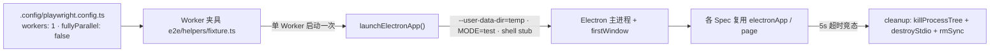

---

title: 端到端测试（Playwright）
description: Playwright 原生 `_electron` 真实拉起应用产物，采用 Worker 级冷启动复用夹具、临时数据隔离与强杀进程树守卫。
---

# 端到端测试（Playwright）

> **TL;DR**：借助 Playwright 原生 `_electron` 引擎直接驱动已编译的 Electron 应用。通过 Worker 级单次冷启动复用夹具压缩测试总耗时，结合隔离的临时 `userDataDir`、全局 `shell` 安全桩、单 Worker 串行执行与 5 秒强杀进程树清理，避免僵尸进程与单实例锁冲突。

> **本页职责边界**：本页负责 Playwright `_electron` 启动参数、Worker 级冷启动夹具、单 Worker 串行配置及进程树/stdio 清理；不负责测试用例内的 `dialog`/`shell` 局部恢复与容差断言写法（见 [端到端断言策略（Shell-stub + Tolerance）](/testing/e2e-assertions)），也不负责打包后产物解包冒烟（见 [产物冒烟测试（Dist-smoke）](/testing/artifact-smoke)）。

## 1. 选型理由

- **原生 `_electron` 直连主进程**：直接通过 Playwright 内置 CDP 通道驱动 Electron 主进程与渲染窗口，摆脱已淘汰的 Spectron 桥接损耗，并支持用 `electronApp.evaluate()` 在主进程上下文打桩和读取窗口状态。
- **Worker 级夹具分摊冷启动开销**：Electron 每次冷启动需 1.5s–3s；通过 Worker 作用域夹具让整套 E2E 共享同一实例，仅在需要验证冷启动或跨重启持久化（如窗口尺寸恢复）时按需独立调用 `launchElectronApp()`。
- **强隔离与进程树清理**：桌面端测试异常退出极易残留僵尸进程并持有单例锁或 stdout 管道，必须在 teardown 阶段显式限时强杀并销毁 stdio。

## 2. 核心机制



### Worker 级全局冷启动复用夹具

`test` 扩展了 `electronCtx`（`scope: 'worker', auto: true`），在 Worker 生命周期内只执行一次 `launchElectronApp()` 与 `cleanup()`，将 `page` 与 `tempUserDataDir` 注入各测试用例复用。

→ 源码：[e2e/helpers/fixture.ts](https://github.com/BanShan-Alec/electron-react-monorepo-template/blob/main/e2e/helpers/fixture.ts)

```ts
// 节选：Worker 级单次冷启动复用，所有用例结束后统一执行 cleanup
export const test = base.extend<TestFixtures, WorkerFixtures>({
  electronCtx: [
    // biome-ignore lint/correctness/noEmptyPattern: Playwright fixtures require object destructuring pattern for dependency analysis
    async ({}, use) => {
      const ctx = await launchElectronApp();
      await use(ctx);
      await ctx.cleanup();
    },
    { scope: 'worker', auto: true },
  ],
  electronApp: [
    async ({ electronCtx }, use) => {
      await use(electronCtx.electronApp);
    },
    { scope: 'worker' },
  ],
  page: async ({ electronCtx }, use) => {
    await use(electronCtx.page);
  },
  tempUserDataDir: async ({ electronCtx }, use) => {
    await use(electronCtx.tempUserDataDir);
  },
});
```

### 启动隔离、Shell 安全桩与进程树清理

`launchElectronApp()` 为每次启动分配独立的 `electron-e2e-*` 临时用户数据目录（支持外部传入 `userDataDir` 测跨重启恢复），注入 `MODE: 'test'` 与 CI 无头参数，并在进入首窗前全局覆盖 `shell` 模块防止 Linux Xvfb 下误唤起 `xdg-open` 孤儿进程；`cleanup()` 用 5 秒超时竞态兜底强杀进程树并销毁 `stdout`/`stderr` 流，彻底解除管道阻塞。

→ 源码：[e2e/helpers/electron.ts](https://github.com/BanShan-Alec/electron-react-monorepo-template/blob/main/e2e/helpers/electron.ts)

```ts
// 节选：启动参数隔离 + 5 秒超时强杀进程树与 stdio 清理
const electronApp = await electron.launch({
  args: [
    '.',
    `--user-data-dir=${tempUserDataDir}`,
    '--disable-gpu',
    '--disable-dev-shm-usage',
    '--no-sandbox',
  ],
  env: { ...process.env, MODE: 'test', ...options.extraEnv },
});
// ... 节选：全局注入 shell 安全桩（openExternal / openPath / showItemInFolder）
const cleanup = async () => {
  try {
    await Promise.race([
      electronApp.close(),
      new Promise((_, reject) => {
        closeTimer = setTimeout(
          () => reject(new Error('electronApp.close() timed out after 5000ms')),
          5000,
        );
      }),
    ]);
  } catch (err) {
    if (pid) killProcessTree(pid, tempUserDataDir);
  } finally {
    if (closeTimer) clearTimeout(closeTimer);
    destroyStdio(proc);
  }
};
```

### 单 Worker 串行配置与运行命令

配置层强制关闭并发（`workers: 1`、`fullyParallel: false`），并在失败时保留 trace 与截图；日常通过 `pnpm test:e2e`（需先有构建产物）或 `pnpm test:e2e:build`（先 `pnpm run build` 再测）执行，异常退出时自动留存 `test-results/` 供排查。

→ 源码：[.config/playwright.config.ts](https://github.com/BanShan-Alec/electron-react-monorepo-template/blob/main/.config/playwright.config.ts)

```ts
// 节选：强制单 Worker 串行执行，避免多窗口焦点与系统资源争抢
export default defineConfig({
  testDir: path.join(ROOT_DIR, 'e2e'),
  timeout: 45000,
  fullyParallel: false,
  workers: 1, // Electron E2E must run sequentially to avoid display/process lock conflicts
});
```

- **官方文档**：[Playwright Electron API](https://playwright.dev/docs/api/class-electron) — 读它能解决什么：掌握 `_electron.launch()` 启动参数、`electronApp.evaluate()` 主进程求值与 `firstWindow()` 生命周期契约。

若需测试冷启动初始尺寸或同 `userDataDir` 跨重启状态恢复，用例应显式调用 `launchElectronApp()` 独立启停实例并在 `finally` 执行 `cleanup()`，避免污染 Worker 复用窗口。

## 3. 桌面端避坑注意事项

| 避坑要点               | 事故表现与原因                                                                                             | 本仓库对齐方案                                                                                                                     |
| :--------------------- | :--------------------------------------------------------------------------------------------------------- | :--------------------------------------------------------------------------------------------------------------------------------- |
| **未先构建即跑 E2E**   | `electron.launch` 以根 `package.json` 的 `main`（即 `packages/main/dist/index.cjs`）为入口，缺产物即报错。 | 本地使用 `pnpm test:e2e:build` 一键先构建再测；CI 的 `e2e` Job 显式在 `test:e2e` 前执行 `pnpm run build`。                         |
| **单例锁与数据污染**   | 共用默认系统 `userData` 会被本地正在运行的开发进程触发单实例锁拦截并静默退出。                             | `launchElectronApp()` 默认创建 `os.tmpdir()` 隔离目录；测跨重启恢复时显式传同一个 `userDataDir` 与 `cleanupUserData: false`。      |
| **退出死锁与管道悬挂** | `electronApp.close()` 因异步 IPC 或孤儿进程持有 stdio 挂起，Worker 45s teardown 超时。                     | 启动期全局注入 `shell` 桩；清理阶段 5s 超时后调用 `killProcessTree`（Win `taskkill /T /F` / POSIX `pkill`）并执行 `destroyStdio`。 |
| **Linux 共享内存溢出** | CI Runner 容器 `/dev/shm` 空间受限，Chromium 渲染大页面崩溃退出。                                          | 启动参数固定追加 `--disable-dev-shm-usage` 与 `--no-sandbox`。                                                                     |
