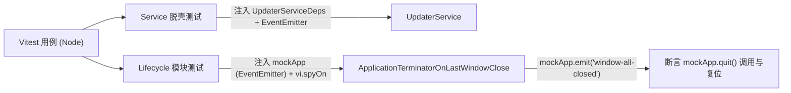

---

title: 主进程单元测试（EventEmitter）
description: 将业务逻辑与系统依赖解耦，纯逻辑通过构造器依赖注入秒测，生命周期模块通过 EventEmitter 与边界打桩。
---

# 主进程单元测试（EventEmitter）

> **TL;DR**：主进程单测无需拉起真实 Electron 运行时。Service 层通过 `UpdaterServiceDeps` 等构造器依赖注入实现脱壳测试；强依赖 `app` 事件的生命周期模块则用 Node 原生 `EventEmitter` 替代 `Electron.App`，配合 `vi.spyOn` 在模块边界打桩并及时复位，实现毫秒级稳定执行。

> **本页职责边界**：本页负责主进程 Service 构造器注入测试与生命周期模块 `EventEmitter` 打桩模式；不负责全仓 Vitest 配置与四包测试命令矩阵（见 [单元测试（Vitest）](/testing/unit-tests)）、主进程遥测性能基准采样（见 [性能基线（Benchmark）](/testing/performance-baseline)），以及真实窗口与原生 IPC 交互（见 [端到端测试（Playwright）](/testing/e2e-electron)）。

## 1. 选型理由

- **摆脱 Electron 运行时冷启动开销**：若在单元测试中真实启动 `electron` 进程并创建 `BrowserWindow`，单次用例耗时将从毫秒级飙升至数秒，且无法在无图形栈的轻量 Node CI 节点直接运行。
- **避免重型全局 Mock 库污染**：第三方 `electron-mock` 类库容易产生全局原型链污染与 Electron 版本滞后，导致单测假绿而生产崩坏。
- **契合分层架构边界**：遵循 Controller / Service 分层后，错误分类、发布源回退、日志行截断等核心逻辑都收敛在无状态 Service 与纯函数中，可通过依赖注入精准验证。

## 2. 核心机制

全仓主进程单测集中在 `packages/main/tests/unit/`，针对「有状态的业务服务」和「订阅 `app` 事件的生命周期模块」分别采用构造器依赖注入与 `EventEmitter` 轻量替身，确保全部用例可在纯 Node 环境下毫秒级跑完。



### 场景一：Service 构造器依赖注入与模块桩

`UpdaterService` 通过可选参数 `deps: UpdaterServiceDeps` 暴露底层 `updater`、`isPackaged`、`hasAppUpdateConfig` 与 `repository` 注入点；测试中对 `electron` 与配置存储做模块边界 `vi.mock`，再用 `EventEmitter` 拼装 `AppUpdater` 即可直接驱动公开 API 断言错误分类与发布源回退。

→ 源码：[packages/main/tests/unit/updater-service.test.ts](https://github.com/BanShan-Alec/electron-react-monorepo-template/blob/main/packages/main/tests/unit/updater-service.test.ts)

```ts
// 节选：通过 UpdaterServiceDeps 构造器注入覆盖打包态与 updater 实例
function createService(updater: AppUpdater, overrides: UpdaterServiceDeps = {}): UpdaterService {
  return new UpdaterService({ updater, repository: TEST_REPOSITORY, ...overrides });
}

function createMockUpdater(overrides?: {
  checkForUpdates?: () => Promise<unknown>;
  downloadUpdate?: (token?: unknown) => Promise<unknown>;
}): AppUpdater {
  const emitter = new EventEmitter();
  return Object.assign(emitter, {
    checkForUpdates: overrides?.checkForUpdates ?? vi.fn().mockResolvedValue(null),
    downloadUpdate: overrides?.downloadUpdate ?? vi.fn().mockResolvedValue([]),
    setFeedURL: vi.fn(),
  }) as unknown as AppUpdater;
}

describe('UpdaterService error classification through public API', () => {
  it('classifies electron-updater network failures by net::ERR_ prefix', async () => {
    const netErr = new Error('Error: net::ERR_CONNECTION_TIMED_OUT');
    const service = createService(
      createMockUpdater({ checkForUpdates: vi.fn().mockRejectedValue(netErr) }),
    );
    await expect(service.check()).rejects.toSatisfy((err) => {
      expect(err).toBeInstanceOf(AppError);
      expect((err as AppError).code).toBe(ErrorCode.UPDATER_NETWORK_ERROR);
      return true;
    });
  });
});
```

### 场景二：生命周期模块用 EventEmitter 模拟 `app`

对于监听 `app.on('window-all-closed')` 的生命周期模块，无需构造完整 `Electron.App`，直接传入挂有 `quit: vi.fn()` 的 `EventEmitter` 作为 `ModuleContext.app`，在 `afterEach` 中同时复位全局单态状态（如 `appLifecycle.isQuitting`）与 `vi.restoreAllMocks()`。

→ 源码：[packages/main/tests/unit/tray-lifecycle.test.ts](https://github.com/BanShan-Alec/electron-react-monorepo-template/blob/main/packages/main/tests/unit/tray-lifecycle.test.ts)

```ts
// 节选：afterEach 复位退出态与 Spy，使用 EventEmitter 驱动 window-all-closed
afterEach(() => {
  // 断言失败时也要复位退出态，避免把 isQuitting 泄漏给后续用例
  appLifecycle.isQuitting = false;
  vi.restoreAllMocks();
});

it('does not quit when minimizeToTray is true and not quitting', () => {
  const mockApp = new EventEmitter() as unknown as Electron.App;
  (mockApp as unknown as { quit: () => void }).quit = vi.fn();

  vi.spyOn(configModule, 'getAppConfigStore').mockReturnValue({
    get: (key: string) => key === 'minimizeToTray',
  } as unknown as ReturnType<typeof configModule.getAppConfigStore>);

  const terminator = new ApplicationTerminatorOnLastWindowClose();
  terminator.enable({
    app: mockApp,
  } as unknown as import('@app/main/ModuleContext').ModuleContext);

  mockApp.emit('window-all-closed');

  expect((mockApp as unknown as { quit: () => void }).quit).not.toHaveBeenCalled();
});
```

### 常用运行命令

开发阶段可通过 `pnpm test` 一键执行四包单元测试，调试单个主进程测试文件时可用 Vitest 路径过滤精确复现：

```bash
pnpm test                                                              # 运行全仓（含主进程）单元测试
pnpm exec vitest run -c .config/vitest.config.ts packages/main/tests/unit/updater-service.test.ts  # 单跑指定主进程测试文件
```

- **官方文档**：[Vitest Mocking Guide](https://vitest.dev/guide/mocking.html) — 读它能解决什么：掌握 `vi.mock` 外部模块替换、`vi.spyOn` 边界打桩与 `vi.restoreAllMocks()` 的作用域清理规则。

测试校验聚焦状态机转换、错误码归类与 `app` 事件响应分支是否符合契约，而不验证渲染层弹窗展示细节。

## 3. 桌面端避坑注意事项

| 避坑要点                 | 事故表现与原因                                                                                           | 本仓库对齐方案                                                                                                                                                                                                           |
| :----------------------- | :------------------------------------------------------------------------------------------------------- | :----------------------------------------------------------------------------------------------------------------------------------------------------------------------------------------------------------------------- |
| **漏用构造器注入对象**   | 将 `mockUpdater` 直接传给 `new UpdaterService(mockUpdater)` 导致运行期把实例当 `deps` 解构，静默失效。   | 按真实签名传 `{ updater: mockUpdater, ... }`；需测打包分支时同步注入 `isPackaged` 与 `hasAppUpdateConfig`。                                                                                                              |
| **跨平台分支随宿主漂移** | CI 运行在 Linux 上而本地在 Windows，涉及 `process.platform` 差异的参数分支（如开机自启）出现断言不一致。 | 在 `beforeEach` 显式锁定 `process.platform`（如 [auto-launch.test.ts](https://github.com/BanShan-Alec/electron-react-monorepo-template/blob/main/packages/main/tests/unit/auto-launch.test.ts)），`afterEach` 恢复原值。 |
| **单态与 Spy 状态泄漏**  | `appLifecycle.isQuitting` 或 `vi.spyOn` 未在 `afterEach` 复位，前一个用例失败拖垮后续所有用例。          | 在 `afterEach` 统一复位单态字段并执行 `vi.restoreAllMocks()`，保持用例绝对隔离。                                                                                                                                         |
| **混淆单测与 E2E 边界**  | 在 Vitest 中模拟真实窗口尺寸、托盘图标点击或热键焦点切换，测试脆弱且失真。                               | 纯逻辑与生命周期状态流转归 Vitest；真实窗口几何、视觉与系统托盘交互交由 Playwright E2E。                                                                                                                                 |
