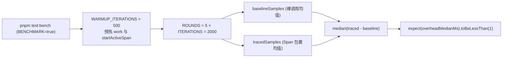

---

title: 性能基线（Benchmark）
description: 采用 JIT 预热与多轮中位数采样消除系统抖动，设置独立门禁守护高频遥测的微秒级开销。
---

# 性能基线（Benchmark）

> **TL;DR**：高频 IPC 与遥测埋点的微秒级开销在功能测试中无法察觉。仓库通过 500 次 JIT 预热、5 轮 × 2000 次对照采样与中位数（Median）聚合配合 10x 回归护栏（`< 1ms`）守护链路追踪性能，并借 `BENCHMARK=true` 与日常单测彻底隔离。

> **本页职责边界**：本页负责主进程遥测链路追踪（`getTracer()`）的 JIT 预热采样模型、回归护栏与 `BENCHMARK=true` 执行方式；不负责 Vitest 通用配置与四包单元测试矩阵（见 [单元测试（Vitest）](/testing/unit-tests)），也不负责 W3C Trace Context 传播与采样落盘架构（见 [全链路追踪（W3C-trace）](/main/tracing)）。

## 1. 选型理由

- **捕获高频调用的隐性退化**：单次 Span 创建若退化 0.5ms，界面肉眼几乎无感，但在密集 IPC 轮询或日志管道中会累积成主进程事件循环卡顿。
- **消除 V8 冷启动与 GC 毛刺**：单次循环测速极易受到 V8 字节码解释执行或垃圾回收（GC）突刺干扰；必须先充分预热 JIT，再取多轮中位数过滤毛刺。
- **与日常 PR 门禁物理隔离**：性能基线受 CI 共享 CPU 调度抖动影响，不得混入 `pnpm test` 拖慢或干扰日常合并门禁，须独立命令按需触发。

## 2. 核心机制

基准套件通过「固定轮次预热 + 同构对照组/实验组差值 + 中位数聚合」将调度噪声剥离出断言，输出 `baselineMedianMs`、`tracedMedianMs`、`overheadMedianMs` 及极值统计供人工巡检。



### 预热与多轮中位数基准采样

测试先执行 `WARMUP_ITERATIONS`（500 次）预热基线工作函数与 `tracer.startActiveSpan`，随后进行 5 轮每轮 2000 次的同构对照采样，最后对每轮差值（`traced - baseline`）求中位数并校验 `< 1ms` 护栏（在 0.1ms 原目标上留出 10x 调度容差，防止数量级性能退化）。

→ 源码：[packages/main/tests/benchmark/tracer-perf.test.ts](https://github.com/BanShan-Alec/electron-react-monorepo-template/blob/main/packages/main/tests/benchmark/tracer-perf.test.ts)

```ts
// 节选：JIT 预热、5 轮对照采样与中位数回归护栏
describe('Performance Benchmark (Spec §6)', () => {
  it('reports tracer overhead across warmed-up rounds instead of a single timing sample', async () => {
    const tracer = getTracer();
    const work = async (value: number) => value * 2;

    // 预热：先让 JIT 稳定，避免首轮解释执行污染基线
    for (let i = 0; i < WARMUP_ITERATIONS; i++) {
      await work(i);
      await tracer.startActiveSpan('benchmark.warmup', undefined, () => work(i));
    }

    const baselineSamples: number[] = [];
    const tracedSamples: number[] = [];
    for (let round = 0; round < ROUNDS; round++) {
      baselineSamples.push(await measurePerCall(work));
      tracedSamples.push(
        await measurePerCall((index) =>
          tracer.startActiveSpan('benchmark.operation', { attributes: { index } }, () =>
            work(index),
          ),
        ),
      );
    }

    const overheadSamples = tracedSamples.map((traced, index) => traced - baselineSamples[index]);
    expect(median(overheadSamples)).toBeLessThan(1);
  });
});
```

### 独立执行与日常门禁隔离

`.config/vitest.config.ts` 通过 `process.env.BENCHMARK === 'true'` 切换测试匹配范围：日常 `pnpm test` 显式排除 `packages/main/tests/benchmark/**`，仅在执行以下命令时独立跑通性能基线（Vitest 通用配置结构见 [单元测试（Vitest）](/testing/unit-tests)）。

推荐在本地空闲 CPU 环境下执行以下命令以获取稳定基准数据：

→ 源码：[package.json](https://github.com/BanShan-Alec/electron-react-monorepo-template/blob/main/package.json)

```bash
pnpm test:bench   # 等价于 cross-env BENCHMARK=true vitest run -c .config/vitest.config.ts
```

控制台会打印每轮统计摘要，确认 `overheadMedianMs` 远低于 `1ms` 即通过回归门禁。若连续多轮中位数逼近或突破 1ms 阈值，应重点排查是否误将同步文件 I/O 或大对象深拷贝带入了 Span 创建热路径。

- **官方文档**：[Node.js `performance.now()`](https://nodejs.org/api/perf_hooks.html#performancenow) — 读它能解决什么：理解 Node 高精度单调时钟在微秒级基准采样中的计时精度与防系统时钟回拨特性。

若需修改采样轮次或回归护栏倍数，应同步评估 CI Runner 与开发机调度噪声后再调整常量。

## 3. 桌面端避坑注意事项

| 避坑要点                 | 事故表现与原因                                                                                 | 本仓库对齐方案                                                                              |
| :----------------------- | :--------------------------------------------------------------------------------------------- | :------------------------------------------------------------------------------------------ |
| **无预热单轮采样翻红**   | 直接循环测一次 `performance.now()`，首轮 JIT 解释执行与偶发 GC 导致耗时成倍放大。              | 固定前置 `WARMUP_ITERATIONS`（500 次）预热，并取 5 轮中位数 `median()` 过滤极端毛刺。       |
| **绝对微秒阈值误报**     | 将断言卡死在 `< 0.1ms`，在笔记本节能模式或后台负载较高时频繁误触失败。                         | 在 0.1ms 目标上保留 10x 宽松护栏（`< 1ms`），聚焦拦截数量级退化而非单机绝对波动。           |
| **基准测试污染日常 CI**  | 若把 `benchmark` 混进 `pnpm test`，共享 CPU 虚拟化抖动会导致 PR 门禁随机翻红。                 | 由 `.config/vitest.config.ts` 的 `BENCHMARK=true` 开关物理隔离，日常 `pnpm test` 自动排除。 |
| **对照组与实验组不同构** | 对照组用同步函数而实验组套了一层 async 闭包，测出的是 Promise 调度差异而非 `tracer` 真实开销。 | `work` 与 `startActiveSpan` 回调保持同构 `async` 签名，仅对比有无 Span 包裹的增量差值。     |
