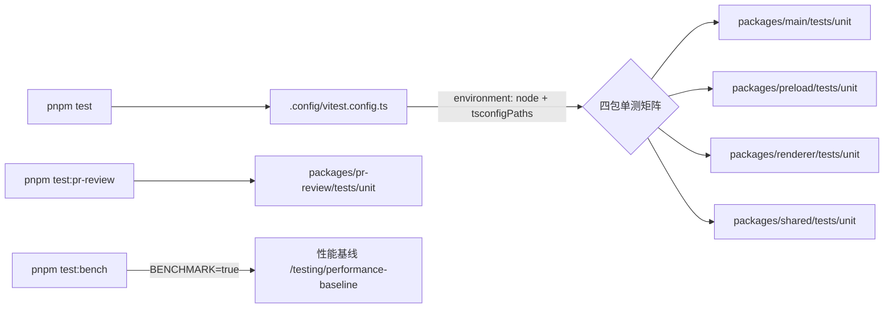

---

title: 单元测试（Vitest）
description: 借助 Vitest 原生 ESM 与别名推导秒级执行全仓单元测试，纯 Node 环境覆盖四包纯逻辑与边界断言。
---

# 单元测试（Vitest）

> **TL;DR**：全仓采用 Vitest 统一驱动单元测试。配置文件收敛至 `.config/vitest.config.ts`，在纯 Node 环境下并行覆盖 `main`、`preload`、`renderer`、`shared` 四个包的纯逻辑与契约校验，通过源码单一真源常量驱动边界断言，DOM 交互交给 Playwright E2E。

> **本页职责边界**：本页负责全仓 Vitest 单测矩阵、运行命令、路径别名与编译期常量对齐；不负责主进程构造器注入与 `EventEmitter` 打桩技巧（见 [主进程单元测试（EventEmitter）](/testing/main-process-tests)）、`BENCHMARK=true` 性能基线采样（见 [性能基线（Benchmark）](/testing/performance-baseline)），以及真实 Electron 窗口测试（见 [端到端测试（Playwright）](/testing/e2e-electron)）。

## 1. 选型理由

- **原生 ESM 与 Vite 共享生态**：直接复用 Vite 8 的 `tsconfigPaths` 别名推导与构建期常量定义，无需像 Jest 那样维护 Babel/ts-jest 转译链路，单测与构建保持同构。
- **纯 Node 环境极致轻量**：全仓单测严格锁定 `environment: 'node'`，不引入 jsdom/happy-dom 模拟浏览器环境；主进程算法、Preload 粘性通道、Renderer 状态映射与 Shared 编解码全部脱壳验证，渲染样式链路通过 `renderToString` 校验。
- **独立工具包隔离**：`packages/pr-review` 作为独立 CLI 工具包拥有自己的测试集，从根测试矩阵中排除并由专属命令驱动，避免工具链回归拖慢日常业务单测。
- **单一事实源驱动断言**：测试文件直接导入源码阈值与枚举常量，拒绝手写魔数导致实现调整后测试假绿。

## 2. 核心机制

全仓 4 个业务包（`main` / `preload` / `renderer` / `shared`）的单元测试均由根目录 `.config/vitest.config.ts` 统一调度，本地开发与 CI `test` Job 共享同一套筛选与路径解析配置。



### 集中式配置与构建期常量对齐

Vitest 配置基于 `findRepoRoot(configDir)` 推导仓库根目录，避免依赖 `process.cwd()` 产生路径偏移；同时与渲染层共享 `__APP_INFO__` 编译期注入，保证消费 `shared/constants/app-info.ts` 的用例可直接求值。完整 `BENCHMARK=true` 隔离逻辑见 [性能基线（Benchmark）](/testing/performance-baseline)。

→ 源码：[.config/vitest.config.ts](https://github.com/BanShan-Alec/electron-react-monorepo-template/blob/main/.config/vitest.config.ts)

```ts
// 节选：根路径推导、路径别名与编译期常量注入
const configDir = path.dirname(fileURLToPath(import.meta.url));
const rootDir = findRepoRoot(configDir);

export default defineConfig({
  root: rootDir,
  tsconfig: path.join(rootDir, 'tsconfig.json'),
  // 别名真源：packages/tsconfig/base.json（Vite 8 原生 tsconfigPaths）
  resolve: {
    tsconfigPaths: true,
  },
  // 与 renderer 同一份构建期注入：shared/constants/app-info.ts 在单测里也要能求值
  define: {
    __APP_INFO__: JSON.stringify(APP_DISPLAY),
  },
  test: {
    environment: 'node',
    globals: true,
  },
});
```

- **官方文档**：[Vitest Configuration](https://vitest.dev/config/) — 读它能解决什么：理解 `environment: 'node'`、`resolve.tsconfigPaths` 与 `include`/`exclude` 过滤规则的底层匹配语义。

### 根脚本运行矩阵

所有单元测试均从仓库根目录通过 `package.json` 脚本统一调度，无需手动拼接配置文件路径：

→ 源码：[package.json](https://github.com/BanShan-Alec/electron-react-monorepo-template/blob/main/package.json)

```bash
pnpm test            # 运行 main / preload / renderer / shared 四包单元测试（排除 benchmark 与 pr-review）
pnpm test:watch      # 监听模式，本地开发增量反馈
pnpm test:pr-review  # 单独运行 packages/pr-review 单元测试（根 pnpm test 已将其排除）
```

### 跨包纯逻辑与源码常量直连断言

四包单测均在无浏览器、无 Electron 窗口的纯 Node 进程中运行：例如 `shared` 校验运行时环境 Base64URL 编解码（[env-packer.test.ts](https://github.com/BanShan-Alec/electron-react-monorepo-template/blob/main/packages/shared/tests/unit/env-packer.test.ts)），`preload` 用轻量 `ipcRenderer` mock 验证粘性事件回放（[sticky.test.ts](https://github.com/BanShan-Alec/electron-react-monorepo-template/blob/main/packages/preload/tests/unit/sticky.test.ts)），`renderer` 用 React `renderToString` 与 `@ant-design/cssinjs` 提取样式校验主题变量（[design-tokens.test.ts](https://github.com/BanShan-Alec/electron-react-monorepo-template/blob/main/packages/renderer/tests/unit/design-tokens.test.ts)），`main` 则直接引入源码阈值常量驱动边界断言：

→ 源码：[packages/main/tests/unit/renderer-log-line.test.ts](https://github.com/BanShan-Alec/electron-react-monorepo-template/blob/main/packages/main/tests/unit/renderer-log-line.test.ts)

```ts
describe('truncateRenderedLine', () => {
  it('should truncate over-long lines and keep the total length within max', () => {
    const line = 'x'.repeat(2500);
    const result = truncateRenderedLine(line);
    const suffix = ' [truncated 500 chars]';

    expect(result).toContain(`[truncated ${500} chars]`);
    expect(result.length).toBe(RENDERER_LINE_MAX_LENGTH);
    expect(result.endsWith(suffix)).toBe(true);
    expect(result.startsWith('x'.repeat(RENDERER_LINE_MAX_LENGTH - suffix.length))).toBe(true);
  });
});
```

## 3. 桌面端避坑注意事项

| 避坑要点                   | 事故表现与原因                                                                        | 本仓库对齐方案                                                                                     |
| :------------------------- | :------------------------------------------------------------------------------------ | :------------------------------------------------------------------------------------------------- |
| **漏跑 `pr-review` 单测**  | 根配置显式排除了 `packages/pr-review/**`，修改该包后只跑 `pnpm test` 会造成测试假绿。 | 改动 `packages/pr-review` 时必须额外执行 `pnpm test:pr-review`。                                   |
| **编译期全局常量未定义**   | 单测引入引用 `__APP_INFO__` 的 `@app/shared` 常量文件时抛出 `ReferenceError`。        | `.config/vitest.config.ts` 的 `define` 与渲染层同步注入 `__APP_INFO__`，新增全局宏须两边对齐。     |
| **测试硬编码破坏单一真源** | 在测试中手写阈值字面量（如 `2000`），源码常量变更后断言与实现脱节。                   | 测试文件直接 `import` 源码常量（如 `RENDERER_LINE_MAX_LENGTH`）做边界断言，保持真源联动。          |
| **工作目录漂移与环境膨胀** | 在子包目录执行命令或引入 jsdom 导致路径失效与内存开销翻倍。                           | 配置文件收口 `.config/` 并用 `findRepoRoot` 定位；单测严守 `node` 环境，真实 DOM 交由 Playwright。 |
