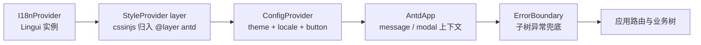

---

title: 组件库（Antd）
description: Ant Design 五层 Provider 装配与 StyleProvider layer 层序配对，样式权重与全局上下文的桌面端解法。
---

# 组件库（Antd）

> **TL;DR**：标准五层 Provider 链式装配；`StyleProvider layer` 把 antd 的 cssinjs 样式收进 `@layer antd`，与全局层序声明配对，让 Tailwind 工具类稳定覆盖组件样式；全局通知与弹窗统一经 `<AntdApp>` 上下文消费。

- **本页负责**：Ant Design v6 的五层 Provider 装配顺序、`StyleProvider layer` 与 Tailwind v4 的 `@layer` 层序兼容，以及 `<AntdApp>` 上下文约定。
- **本页不负责**：品牌种子与三层语义变量映射见 [设计规范与令牌](/ui/design-tokens)；跨进程主题切换与首帧同步链路见 [主题链路](/ui/theme-pipeline)；渲染层异常兜底见 [错误边界](/ui/error-boundary)。

## 1. 选型理由

桌面应用需要成熟稳定的底层控件（表格、表单、Select、Modal），Ant Design 6 提供完整组件生态。本仓库的集成焦点只有两件事：

1. **装配出职责清晰的 Provider 栈**：把多语言、样式层序、主题令牌、全局反馈上下文和错误边界按依赖顺序套好。
2. **解决 CSS-in-JS 与实用类的权重争端**：在不写 `!important` 和不手写 `.ant-*` 补丁的前提下，让 Tailwind 工具类稳定覆盖默认组件样式。

官方参考：[Ant Design 兼容样式（CSS 层序）](https://ant.design/docs/react/compatible-style)（读它能理解 `@ant-design/cssinjs` 的 `StyleProvider layer` 如何把组件样式收进 `@layer antd`，以及与 Tailwind CSS 叠层时的声明顺序要求）。

## 2. 核心机制



### 标准五层 Provider 链式装配

→ 源码：[packages/renderer/src/components/layout/AppProviders/index.tsx](https://github.com/BanShan-Alec/electron-react-monorepo-template/blob/main/packages/renderer/src/components/layout/AppProviders/index.tsx)

```tsx
// 节选：五层 Provider 嵌套结构（省略 usePlatform / useTheme 与 config.get/onChanged 同步 Effect）
export const AppProviders: React.FC<{ children: React.ReactNode }> = ({ children }) => {
  return (
    <I18nProvider i18n={i18n}>
      <StyleProvider layer>
        <ConfigProvider
          button={{ autoInsertSpace: false }}
          theme={getAntdThemeConfig(resolvedTheme)}
          locale={getAntdLocale(language)}
        >
          <AntdApp>
            <ErrorBoundary>{children}</ErrorBoundary>
          </AntdApp>
        </ConfigProvider>
      </StyleProvider>
    </I18nProvider>
  );
};
```

自外向内各司其职：

- `I18nProvider` 注入 Lingui 实例（语言按需加载见 [国际化](/ui/i18n)）；
- `StyleProvider` 将 cssinjs 样式收敛至 `@layer antd`；
- `ConfigProvider` 注入主题算法与 locale，并关闭中文双字按钮自动插空格（`autoInsertSpace: false`）；
- `<AntdApp>` 承接消费主题与语言的静态通知上下文；
- `ErrorBoundary` 在最内层兜底业务树并能正常渲染 Antd 兜底界面（见 [错误边界](/ui/error-boundary)）。

### 层序基石：@layer 声明与 StyleProvider layer 配对

→ 源码：[packages/renderer/src/styles/index.css](https://github.com/BanShan-Alec/electron-react-monorepo-template/blob/main/packages/renderer/src/styles/index.css)

样式入口首行显式声明五层层序：`@layer theme, base, antd, components, utilities;`。

antd 默认以高特异性内联 `<style>` 注入样式，仅靠声明层序收不住它——必须配对 `<StyleProvider layer>` 将 cssinjs 产物显式包裹进 `@layer antd`。此后覆盖关系只看层级位置、不看选择器权重与注入时机：`utilities > antd`，Tailwind 工具类可稳定覆盖组件默认样式。

## 3. 桌面端避坑注意事项

- **`<StyleProvider layer>` 与层序声明必须成对出现**：只声明 `@layer` 不开启 `layer`，antd 样式留在层外，`p-4` 等工具类因权重不足无法覆盖；只开 `layer` 不声明层序，`@layer antd` 无处锚定，覆盖关系退回注入顺序。
- **全局通知与弹窗必须经 `<AntdApp>` 上下文**：严禁在 React 树外裸调 `message.success()` 或 `Modal.confirm()`，否则会丢失主题算法与语言包 Context；统一通过 `const { message, modal } = AntdApp.useApp()` 取用。
- **不在业务组件里手写 `.ant-*` 样式补丁**：组件配色与密度通过 `getAntdThemeConfig` 与 Tailwind 语义类调整，避免版本升级或切换深色模式时失效（令牌规则见 [设计规范与令牌](/ui/design-tokens)）。
