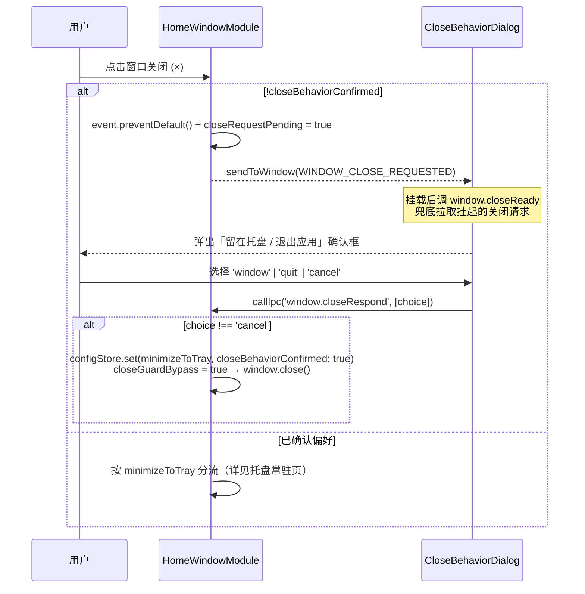

---

title: 首次关闭确认（Close-confirmation）
description: 拦截主窗口首次关闭事件，交互确认托盘常驻或彻底退出，配置持久化与设置页反悔入口。
---

# 首次关闭确认（Close-confirmation）

> **TL;DR**：主进程拦截主窗口首次关闭事件（`!closeBehaviorConfirmed`），通过 `closeReady` 握手与渲染端弹窗确认「留在托盘」或「退出应用」；决策写入 `ConfigStore` 后重放 `window.close()` 进入托盘/退出分流，设置页可随时更改。

- **本页负责**：首次点击关闭按钮的拦截状态机（`closeBehaviorConfirmed` / `closeRequestPending` / `closeGuardBypass`）、`closeReady` 就绪握手、渲染端确认弹窗与设置页修改入口。
- **本页不负责**：确认后的「关闭自然销毁退守托盘」与单实例唤醒机制见 [托盘常驻与单实例](/main/tray-single-instance)；配置 schema 与落盘自愈见 [配置持久化](/main/config-persistence)。

## 1. 选型理由

桌面应用点击右上角 `×` 存在预期分歧：后台常驻工具通常希望关闭窗口后留在系统托盘继续运行，但默认静默退守托盘会让习惯直接退出的用户误以为窗口关不掉或程序卡死。

本工程采用「首次关闭弹窗询问 + 记忆选择 + 设置页随时改回」消除歧义：在首次关闭前把控制权显式交给用户，并将确认结果持久化至 `ConfigStore`。

官方参考：[Electron BrowserWindow `close` 事件](https://www.electronjs.org/docs/latest/api/browser-window#event-close)（读它能确认 `event.preventDefault()` 拦截关闭的时机，以及主动 `app.quit()` 与窗口 `close` 事件的触发关系）。

## 2. 核心机制



### 主进程首次拦截与决策回放

→ 源码：[packages/main/src/modules/window/home-window.module.ts](https://github.com/BanShan-Alec/electron-react-monorepo-template/blob/main/packages/main/src/modules/window/home-window.module.ts)

```ts
// 节选：createWindow 中的首次关闭拦截（已确认后的托盘/退出分流略）
browserWindow.on('close', (event) => {
  if (appLifecycle.isQuitting) {
    this.closeRequestPending = false;
    return;
  }

  if (this.closeGuardBypass) {
    this.closeGuardBypass = false;
  } else if (!getAppConfigStore().get('closeBehaviorConfirmed')) {
    event.preventDefault();
    if (!this.closeRequestPending) {
      this.closeRequestPending = true;
      getLogManager().scoped(this).info('First close intercepted; asking renderer');
    }
    sendToWindow(WINDOW_IDS.HOME, IPC_CHANNELS.WINDOW_CLOSE_REQUESTED, null);
    return;
  }
  // ... 已确认：按 minimizeToTray 决定自然销毁或 quitAfterCancellingUpdate()
});
```

用户做出非 `'cancel'` 选择后，主进程 `respondCloseRequest` 写入 `{ minimizeToTray: choice === 'window', closeBehaviorConfirmed: true }` 并广播配置变更，置位 `closeGuardBypass = true` 后再次调用 `window.close()` 放行进入常规分流（常规分流见 [托盘常驻与单实例](/main/tray-single-instance)）。

### 渲染端就绪握手与决策回传

渲染端挂载 `CloseBehaviorDialog` 时订阅 `window.api.window.onCloseRequested`，并主动发送 `callIpc('window.closeReady')`——若用户手速极快在 React 挂载前就点过关闭，主进程 `markRendererReady()` 会立刻补发一次通知。点击按钮后通过 `callIpc('window.closeRespond', [choice])` 回传决策：

→ 源码：[packages/renderer/src/components/close-behavior/CloseBehaviorDialog/index.tsx](https://github.com/BanShan-Alec/electron-react-monorepo-template/blob/main/packages/renderer/src/components/close-behavior/CloseBehaviorDialog/index.tsx)

```tsx
// 节选：决策回传与 closeReady 握手（省略 Modal 配置与焦点 ref）
const respond = async (choice: CloseBehaviorChoice) => {
  currentModal?.destroy();
  currentModal = null;
  try {
    await callIpc('window.closeRespond', [choice]);
  } catch (error) {
    logger.warn('Failed to submit close behavior choice:', error);
    message.error(t`提交关闭选择失败`);
    showPrompt();
  }
};

const unsubscribe = window.api.window.onCloseRequested(showPrompt);
void callIpc('window.closeReady').catch((error) => {
  logger.warn('Failed to register close prompt handler:', error);
});
```

## 3. 桌面端避坑注意事项

- **防启动竞态与重复弹窗**：在弹窗显示期间连点 `×` 时，主进程用 `closeRequestPending` 避免重复刷日志，渲染端用 `if (currentModal) return;` 防止弹窗堆叠；`CloseBehaviorDialog` 挂载即发 `window.closeReady`，确保首帧刚就绪时点关闭不会丢信号。
- **焦点对齐与无超时策略**：弹窗禁用遮罩点击与 ESC 关窗（`mask: { enabled: true, closable: false }`、`keyboard: false`），点击右上角 `×` 走 `respond('cancel')` 放弃本次关闭；推荐按钮「留在托盘」同时用 `autoFocus`、`afterOpenChange` 与 `requestAnimationFrame` 三重保底聚焦，且永不设置超时自动关窗。
- **选择退出时有界取消在途更新**：选择 `'quit'` 放行退出时，主进程通过 `quitAfterCancellingUpdate()` 在 `2000ms` 超时保护内取消正在进行的更新下载，再调 `app.quit()`。
- **设置页反悔同时置位已确认标记**：用户在 [SettingsCard](https://github.com/BanShan-Alec/electron-react-monorepo-template/blob/main/packages/renderer/src/features/settings/components/SettingsCard/index.tsx) 拨动「关闭后保留在托盘」开关时，会一并提交 `closeBehaviorConfirmed: true`，之后首次点 `×` 不再重复弹窗。
