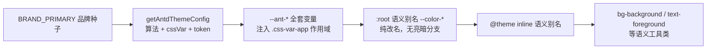

---

title: 设计规范与令牌（Design Tokens）
description: 品牌种子经 Ant Design 官方算法派生全套色阶：算法配置、cssVar 作用域挂载与三层语义映射的静态全链。
---

# 设计规范与令牌（Design Tokens）

> **TL;DR**：全仓色彩源于唯一种子 `BRAND_PRIMARY`，经 Ant Design 官方算法派生 `--ant-*` 变量，映射为语义别名 `--color-*` 后由 Tailwind `@theme inline` 生成工具类；`applyColorScheme` 把 cssVar 作用域挂上 `<html>`，Portal 浮层才不脱色。

## 1. 选型理由

桌面端界面最容易在维护中演变为「视觉灾难」：

1. **硬编码色值泛滥**：业务组件充斥 `#10b981`、`text-white`，切深色模式时半边页面失控。
2. **Portal 浮层掉色**：下拉、模态挂载在 `document.body`，脱离局部作用域导致样式丢失。
3. **组件库补丁破碎**：全局手写大量 `.ant-card { ... }` 覆盖，组件库小版本升级即全盘崩溃。
4. **明暗两套色板脱节**：业务侧自维护一套深浅颜色，与组件库算法各改各的，色值必然漂移。

对应的解法是一条单向派生管道：颜色只有一个入口（种子），其余全部由算法与映射派生，业务只消费末端语义类。本页讲静态定义；「变化」维度（切换如何传播、首帧如何不闪）见 [主题链路](/ui/theme-pipeline)。

## 2. 核心机制



亮暗差异不在管道里出现两次：算法在运行时按明暗改写同一批 `--ant-*` 的值，映射层与工具类对此无感。

### 算法源头：一个种子与官方算法

→ 源码：[packages/renderer/src/styles/antd-theme.ts](https://github.com/BanShan-Alec/electron-react-monorepo-template/blob/main/packages/renderer/src/styles/antd-theme.ts)

```ts
export function getAntdThemeConfig(mode: ResolvedTheme) {
  return {
    algorithm: mode === 'dark' ? theme.darkAlgorithm : theme.defaultAlgorithm,
    cssVar: { key: CSS_VAR_KEY },
    token: {
      colorPrimary: BRAND_PRIMARY,
      controlHeightSM: 28,
    },
  };
}
```

`algorithm` 由明暗决定色板派生方向；`cssVar` 开启后全部 token 以 `--ant-*` CSS 变量形式注入作用域，而非编译期内联；`token.colorPrimary` 是唯一种子，`controlHeightSM: 28` 是桌面紧凑密度的刻意选择。换品牌色只改 `BRAND_PRIMARY` 一处，完成判据见 [主题链路](/ui/theme-pipeline) 的改动落点判据。

### 作用域挂载：applyColorScheme

→ 源码：[packages/renderer/src/styles/design-tokens.ts](https://github.com/BanShan-Alec/electron-react-monorepo-template/blob/main/packages/renderer/src/styles/design-tokens.ts)

上层 `useAppStore` 解析出最终的 `ResolvedTheme`（`'light' | 'dark'`），由原子函数挂载至 `<html>` 根节点：

```ts
export const BRAND_PRIMARY = '#1677ff';
export const CSS_VAR_KEY = 'css-var-app';

export function applyColorScheme(mode: ResolvedTheme): void {
  const root = document.documentElement;
  root.dataset.theme = mode;
  root.classList.add(CSS_VAR_KEY);
}
```

`data-theme` 同时驱动 tokens.css 的 `color-scheme` 与滚动条/语法高亮深色变量；`css-var-app` 类是 `--ant-*` 可解析的前提。挂载时机与运行时联动见 [主题链路](/ui/theme-pipeline)。

### 语义桥：:root 映射与 @theme inline

→ 源码：[packages/renderer/src/styles/index.css](https://github.com/BanShan-Alec/electron-react-monorepo-template/blob/main/packages/renderer/src/styles/index.css)

```css
/* 节选：两段映射（省略层序声明、组件样式与字体令牌） */
@layer base {
  :root {
    --color-bg-primary: var(--ant-color-bg-layout);
    --color-bg-container: var(--ant-color-bg-container);
    --color-bg-elevated: var(--ant-color-bg-elevated);
    --color-bg-sunken: var(--ant-color-fill-alter);
    --color-text-primary: var(--ant-color-text);
    --color-text-secondary: var(--ant-color-text-secondary);
    --color-text-muted: var(--ant-color-text-tertiary);
    --color-text-on-primary: var(--ant-color-text-light-solid);
    --color-border: var(--ant-color-border);
    --color-primary: var(--ant-color-primary);
    --color-primary-hover: var(--ant-color-primary-hover);
    --color-primary-light: var(--ant-color-primary-bg);
    --color-success: var(--ant-color-success);
    --color-warning: var(--ant-color-warning);
    --color-danger: var(--ant-color-error);
  }
}

/* …省略… */

@theme inline {
  --color-background: var(--color-bg-primary);
  --color-foreground: var(--color-text-primary);
  --color-border: var(--color-border);
  /* …与 :root 一一对应，省略… */
}
```

两层映射各司其职：`:root` 只做**改名**（背景 4 / 文字 4 / 主色 3 / 描边 1 / 语义 3），让业务与 Tailwind 不依赖 `--ant-*` 命名；`@theme inline` 把语义变量注册为 Tailwind 工具类（`bg-background`、`text-foreground` 等）。`inline` 必须带：映射值是 `var()` 引用，无 `inline` 会生成变量自引用死循环。Tailwind 侧以 `source(none)` + `@source "../"` 把扫描圈定在 `src/`，语义类才会生成。

## 3. 桌面端避坑注意事项

- **作用域类名必须挂在 `<html>` 根节点**：挂在 React `#root` 上，`createPortal` 渲染的下拉、Modal、Tooltip 全部脱离变量作用域，深色模式下透明底黑字。
- **`cssVar.key` 是完整的类名而非前缀**：`cssVar: { key: 'css-var-app' }` 直接生成 `.css-var-app` 选择器，只传 `app` 会得到 `.app`。
- **业务代码禁止直读 `--ant-*`**：统一消费 Tailwind 语义类或通用包装器（如 `AppCard`）；`pnpm verify:prebuild` 静态扫描并拦截违规写法。
- **`@theme inline` 必须带 `inline`**：无 `inline` 时 Tailwind 尝试预置变量值，`var()` 引用会生成 `--color-background: var(--color-background)` 自引用死循环。
- **不给映射变量写硬编码 Fallback**：映射链断了应当直接透明显形（配合单元测试第一时间暴露），而不是悄悄退回另一套颜色。
- **禁止 `dark:` 业务类堆砌**：明暗差异由 `data-theme` 与算法全自动派发，逐个元素写 `dark:bg-gray-900` 违反单一真源；dark 变体机制已从样式中删除，`data-theme` 是唯一根契约。
