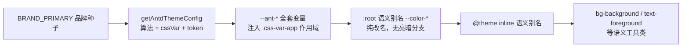

---

title: 设计规范与令牌（Design Tokens）
description: 品牌种子经 Ant Design 官方算法派生全套色阶：算法配置、cssVar 作用域挂载与三层语义映射的静态全链。
---

# 设计规范与令牌（Design Tokens）

> **TL;DR**：全仓色彩源于唯一种子 `BRAND_PRIMARY`，经 Ant Design 官方算法派生 `--ant-*` 变量，映射为语义别名 `--color-*` 后由 Tailwind `@theme inline` 生成工具类；`applyColorScheme` 把 cssVar 作用域挂上 `<html>`，Portal 浮层才不脱色。

- **本页负责**：品牌种子 `BRAND_PRIMARY`、cssVar 作用域挂载（`CSS_VAR_KEY`）、`:root` 与 `@theme inline` 三层静态映射，以及样式令牌门禁规则。
- **本页不负责**：Provider 装配与 `@layer` 层序兼容见 [组件库（Antd）](/ui/antd)；主题切换跨进程传播与首帧防闪烁见 [主题链路](/ui/theme-pipeline)。

## 1. 选型理由

桌面端界面在维护中最容易遇到四类样式退化：**硬编码色值散落**（切深色模式时半边页面失控）、**Portal 浮层掉色**（下拉与 Modal 挂载在 `document.body` 脱离局部作用域）、**`.ant-*` 覆盖补丁脆弱**、以及**业务侧另维护一套色板导致明暗漂移**。

对应解法是一条单向派生管道：颜色只有一个入口（品牌种子），其余全部由算法与映射派生，业务只消费末端语义类。

官方参考：[Ant Design 定制主题与 CSS 变量](https://ant.design/docs/react/customize-theme)（读它能查清 `cssVar` 模式如何由 `algorithm` 运行时派生 `--ant-*` 变量，以及 `cssVar.key` 与全局 Token 的命名边界）。

## 2. 核心机制



亮暗差异不在映射管道里出现两次：算法在运行时按明暗改写同一批 `--ant-*` 的值，映射层与工具类对此无感。

### 算法源头：一个种子与官方算法

→ 源码：[packages/renderer/src/styles/antd-theme.ts](https://github.com/BanShan-Alec/electron-react-monorepo-template/blob/main/packages/renderer/src/styles/antd-theme.ts)

```ts
export function getAntdThemeConfig(mode: ResolvedTheme) {
  return {
    algorithm: mode === 'dark' ? theme.darkAlgorithm : theme.defaultAlgorithm,
    cssVar: { key: CSS_VAR_KEY },
    token: {
      colorPrimary: BRAND_PRIMARY,
      controlHeightSM: 28,
    },
  };
}
```

`algorithm` 由明暗决定色板派生方向；`cssVar` 开启后全部 token 以 `--ant-*` 变量注入作用域而非编译期内联；`token.colorPrimary` 是唯一种子，`controlHeightSM: 28` 是桌面紧凑密度的刻意取舍。改品牌主色只动 `BRAND_PRIMARY` 一处，验收判据见 [主题链路](/ui/theme-pipeline)。

### 作用域挂载：applyColorScheme

→ 源码：[packages/renderer/src/styles/design-tokens.ts](https://github.com/BanShan-Alec/electron-react-monorepo-template/blob/main/packages/renderer/src/styles/design-tokens.ts)

```ts
export const BRAND_PRIMARY = '#1677ff';
export const CSS_VAR_KEY = 'css-var-app';

export function applyColorScheme(mode: ResolvedTheme): void {
  const root = document.documentElement;
  root.dataset.theme = mode;
  root.classList.add(CSS_VAR_KEY);
}
```

`data-theme` 同时驱动 `tokens.css` 的 `color-scheme` 与滚动条/语法高亮深色变量；`css-var-app` 类是 `:root` 下 `--ant-*` 可解析的前提，挂载时机与运行时联动见 [主题链路](/ui/theme-pipeline)。

### 语义桥：:root 映射与 @theme inline

→ 源码：[packages/renderer/src/styles/index.css](https://github.com/BanShan-Alec/electron-react-monorepo-template/blob/main/packages/renderer/src/styles/index.css)

```css
/* 节选：两层语义改名决策（完整 15 个语义色与字体令牌见源码 index.css） */
@layer base {
  :root {
    --color-bg-primary: var(--ant-color-bg-layout);
    --color-text-primary: var(--ant-color-text);
    --color-primary: var(--ant-color-primary);
    /* …背景 4 / 文字 4 / 主色 3 / 描边 1 / 语义 3，纯改名无亮暗分支… */
  }
}

@theme inline {
  --color-background: var(--color-bg-primary);
  --color-foreground: var(--color-text-primary);
  /* …必须带 inline：映射值为 var() 引用，避免生成自引用死循环… */
}
```

两层映射各司其职：`:root` 只做**改名**，隔离 `--ant-*` 命名依赖；`@theme inline` 把语义变量注册为 Tailwind 工具类（`bg-background`、`text-foreground` 等）。Tailwind 侧通过 `source(none)` + `@source "../"` 把扫描圈定在 `src/` 内，确保只生成有效语义类。

## 3. 桌面端避坑注意事项

- **作用域类名必须挂在 `<html>` 根节点**：挂在 React `#root` 上会导致 `createPortal` 渲染的下拉、Modal、Tooltip 全部脱离变量作用域，深色模式下出现透明底黑字。
- **`cssVar.key` 是完整类名而非前缀**：`cssVar: { key: 'css-var-app' }` 直接生成 `.css-var-app` 选择器，误传 `'app'` 会生成 `.app` 导致与 `applyColorScheme` 失配。
- **业务代码禁止直读 `--ant-*` 或写死 hex 颜色**：统一消费 Tailwind 语义类或 `--color-*`；`pnpm verify:prebuild` 会静态扫描 `packages/renderer/src` 拦截违规字号（`text-[Npx]`）、`var(--ant-*)` 与种子外 hex 色值。
- **`@theme inline` 必须带 `inline` 且不写硬编码 Fallback**：无 `inline` 时 `var()` 会形成自引用死循环；不写 Fallback 让断链立刻透明显形（配合单元测试第一时间暴露）。
- **禁止 `dark:` 业务类堆砌**：明暗差异由 `data-theme` 与官方算法全自动派发，逐元素写 `dark:*` 违反单一真源。
