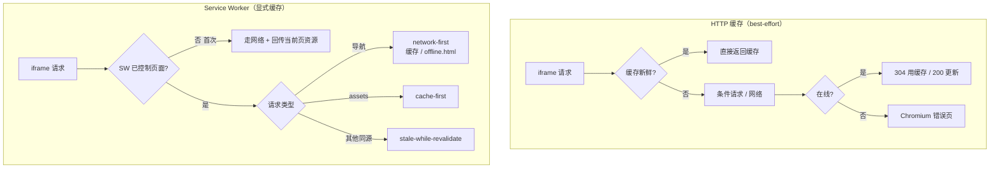

---

title: 文档站离线缓存（Service-Worker）
description: HTTP 缓存只能 best-effort，Service Worker 用显式 Cache Storage 保证访问过的页面离线可读，在线时 HTML 仍优先取新。
---

# 文档站离线缓存（Service-Worker）

> **TL;DR**：HTTP 缓存的离线能力取决于浏览器是否愿意用 stale，过期就是错误页；Service Worker 用显式 Cache Storage 保存访问过的页面与资源，导航 network-first、`assets/` cache-first，未缓存页面回退到跟随系统主题的 `offline.html`。

- **本页负责**：文档站 Service Worker（`sw.js`）运行时缓存策略、首访补缓存握手、`offline.html` 离线兜底及嵌入态自感知。
- **本页不负责**：应用侧对文档站 iframe 的 `frame-src` 放行与「CSP 仅注主框架」策略见 [内容安全策略（CSP）](/security/csp)；文档站 iframe 的加载状态与超时遮罩见 [功能域组织](/architecture/feature-domains)。

## 1. 选型理由

文档站同时部署在公开 GitHub Pages 与应用内嵌 iframe 中，目标是「访问过一次，之后离线仍可读」。单纯依赖浏览器 HTTP 缓存无法达标：

1. **HTTP 缓存只是 best-effort**：GitHub Pages 仅下发 `Cache-Control: max-age=600`，过期或被淘汰后离线就会落入 Chromium 错误页。
2. **不做全量 precache**：对整站静态产物做预缓存会带来高昂首访成本与每次部署全量重算，因此只在运行时按访问动态缓存。
3. **必须由文档站同源注册**：应用顶层为 `file://` 或 `localhost`，与 GitHub Pages 跨 origin，只能由文档站自身注册 Service Worker。

官方参考：[MDN Service Worker API](https://developer.mozilla.org/en-US/docs/Web/API/Service_Worker_API)（读它能厘清 `install`/`activate`/`fetch` 生命周期、`registration.scope` 同源范围限制以及 `CacheStorage` 与 HTTP 缓存的层级关系）。

## 2. 核心机制：两条缓存链路



### 同源请求三路缓存分发

SW 拦截同源且匹配 `SCOPE_PATH` 的 `GET` 请求并按资源类型分流：

- **导航请求**：`networkFirst` 显式携带 `cache: 'no-cache'` 绕过 `max-age=600`，在线优先拿最新 HTML，断网回退缓存或 `offline.html`；
- **`assets/` 资源**：构建带哈希的静态资产走 `cacheFirst`；
- **其余同源请求**：走 `staleWhileRevalidate`，兼顾命中速度与后台刷新。

→ 源码：[packages/docs/public/sw.js](https://github.com/BanShan-Alec/electron-react-monorepo-template/blob/main/packages/docs/public/sw.js)

```js
// 节选：同源 GET 请求的三路缓存分发
self.addEventListener('fetch', (event) => {
  const { request } = event;
  if (request.method !== 'GET') return;

  const url = new URL(request.url);
  if (url.origin !== self.location.origin || !url.pathname.startsWith(SCOPE_PATH)) return;

  if (request.mode === 'navigate') {
    event.respondWith(networkFirst(request));
    return;
  }

  if (url.pathname.startsWith(`${SCOPE_PATH}assets/`)) {
    event.respondWith(cacheFirst(request));
    return;
  }

  event.respondWith(staleWhileRevalidate(request));
});
```

### 首访补缓存与嵌入自感知

[vocs.config.ts](https://github.com/BanShan-Alec/electron-react-monorepo-template/blob/main/packages/docs/vocs.config.ts) 仅在非 `dev` 态注入 SW 注册脚本（携带 `updateViaCache: 'none'`），并在 `navigator.serviceWorker.ready` 后通过 `postMessage({ type: 'CACHE_URLS' })` 回传首屏 HTML 与已加载资源，补齐首次访问未受 SW 控制的空窗期；[offline.html](https://github.com/BanShan-Alec/electron-react-monorepo-template/blob/main/packages/docs/public/offline.html) 通过 `prefers-color-scheme` 自动跟随浅/深主题。

## 3. 桌面端避坑注意事项

| 避坑要点                       | 事故表现与原因                                                     | 本仓库对齐方案                                                                                  |
| :----------------------------- | :----------------------------------------------------------------- | :---------------------------------------------------------------------------------------------- |
| **首次访问 SW 未控制页面**     | 首屏 HTML/JS/CSS 不会被 `fetch` 事件截到，断网后首屏缺资源         | SW ready 后页面通过 `CACHE_URLS` 回传当前页 HTML 与已加载资源，由 SW 主动缓存                   |
| **GH Pages `max-age=600`**     | 在线时 10 分钟内可能不拿新 HTML；`sw.js` 也可能被 HTTP 缓存        | 注册配置 `updateViaCache: 'none'`；导航请求显式带 `cache: 'no-cache'`                           |
| **Cache Storage 是 origin 级** | `caches.keys()` 会列出同 origin 其他 GH Pages 项目缓存，全删会误伤 | 缓存名前缀从 `registration.scope` 推导（`CACHE_PREFIX`），`activate` 只清理本前缀旧版本         |
| **dev 注册会缓存 Vocs HMR**    | 本地开发时热更新请求被 SW 缓存挡住                                 | `vocs.config.ts` 按 `isDev` 判断，仅生产构建注入 SW 注册脚本                                    |
| **keep-alive 不自动更新**      | 应用内切 tab 只用 `invisible` 隐藏 iframe，SW/新 HTML 不会自动刷新 | SW 只保证重载与离线路径；获取最新内容需点击重试重载 iframe 或重启应用                           |
| **坏 SW 的恢复**               | SW 持久化在 Electron session 中，线上修好后客户端仍可能跑旧 SW     | 升级 `VERSION` 配合 `skipWaiting()` + `clients.claim()` 覆盖；必要时清理站点数据                |
| **iframe 嵌入宿主解耦**        | 依赖宿主向 URL 拼接 `?embed=true` 易产生跨进程参数与时序耦合       | `vocs.config.ts` 通过 `window.self !== window.top` 自感知嵌入并加 `.is-embedded` 类隐藏冗余顶栏 |

- **跨源 iframe 的安全与沙箱前提不在本页展开**：文档站能在 Electron 内嵌 iframe 正常注册 SW，依赖宿主侧保留 `allow-same-origin` 以及主进程只向 `mainFrame` 注入 CSP 并放行文档站 `frame-src`，策略配置见 [内容安全策略（CSP）](/security/csp)。
