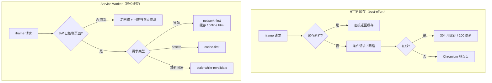

---

title: 文档站离线缓存（Service-Worker）
description: HTTP 缓存只能 best-effort，Service Worker 用显式 Cache Storage 保证访问过的页面离线可读，在线时 HTML 仍优先取新。
---

# 文档站离线缓存（Service-Worker）

> **TL;DR**：HTTP 缓存的离线能力取决于浏览器是否愿意用 stale，过期就是错误页；Service Worker 用显式 Cache Storage 保存访问过的页面与资源，导航 network-first、`assets/` cache-first，未缓存页面回退到跟随主题的 `offline.html`。

## 1. 选型理由

文档站同时部署在公开 GitHub Pages 和 app 的 iframe 里，目标是「访问过一次，之后离线也能看」。只靠浏览器 HTTP 缓存做不到：

1. **HTTP 缓存是 best-effort**：GH Pages 只给 `Cache-Control: max-age=600`，过期、被淘汰或浏览器不愿用 stale 时，离线就是 Chromium 错误页。
2. **SW 的 Cache Storage 是显式缓存**：install 缓存离线页，fetch 按请求类型分流；离线时由 SW 决定返回缓存还是 `offline.html`。
3. **不做全量 precache**：站点 23MB / 423 文件，全量缓存首访成本高、每次部署都要重算；运行时缓存只覆盖「看过的页面」。
4. **必须由文档站自己注册**：SW 只能由同 origin 的页面注册；app 的 `file://`/`localhost` 与文档站 `https://banshan-alec.github.io` 跨 origin，无法代注册。

## 2. 核心机制：两条缓存链路

两条链路的差别在「离线时有没有兜底」：HTTP 缓存过期/未命中时直接落到 Chromium 错误页；SW 的 Cache Storage 显式保存访问过的页面，离线时由 SW 返回缓存或 `offline.html`。SW 仍然站在 HTTP 缓存前面，在线时导航用 `cache: 'no-cache'` 重新验证，所以不会比 HTTP 缓存更旧。

实现位置：[sw.js](https://github.com/BanShan-Alec/electron-react-monorepo-template/blob/main/packages/docs/public/sw.js)、[vocs.config.ts](https://github.com/BanShan-Alec/electron-react-monorepo-template/blob/main/packages/docs/vocs.config.ts)、[offline.html](https://github.com/BanShan-Alec/electron-react-monorepo-template/blob/main/packages/docs/public/offline.html)。

## 3. 桌面端避坑注意事项

| 避坑要点                       | 事故表现与原因                                                                     | 本仓库对齐方案                                                                                     |
| :----------------------------- | :--------------------------------------------------------------------------------- | :------------------------------------------------------------------------------------------------- |
| **首次访问 SW 未控制页面**     | 首屏 HTML/JS/CSS 不会被 SW 截到，断网后首屏缺资源                                  | SW ready 后页面回传当前页 HTML 与已加载资源，SW 主动缓存                                           |
| **GH Pages `max-age=600`**     | 在线时 10 分钟内可能不拿新 HTML；`sw.js` 也可能被 HTTP 缓存                        | 注册 `updateViaCache: 'none'`；导航 `cache: 'no-cache'`                                            |
| **Cache Storage 是 origin 级** | `caches.keys()` 会看到同 origin 其他 GH Pages 项目的缓存，全删会误伤               | 缓存名前缀从 `registration.scope` 推导，activate 只删本前缀                                        |
| **dev 注册会缓存 Vocs HMR**    | 开发时热更新被 SW 缓存挡住                                                         | dev 不注入注册脚本                                                                                 |
| **Electron 顶层是 `file://`**  | 跨源 iframe 的 SW 注册依赖 iframe 的 `allow-same-origin`；CSP 若全量注入会拦文档站 | docs tab 的 iframe 保留 `allow-same-origin`；CSP 只注主框架并放行 docs origin 的 `frame-src`       |
| **keep-alive 不自动更新**      | 切 tab 不卸载 iframe，SW/新 HTML 不会自动进当前页                                  | SW 只保证重载/离线路径；需要新内容时重载 iframe 或重启 app                                         |
| **坏 SW 的恢复**               | SW 持久化在 Electron session，服务器修好后仍可能服务旧内容                         | 版本 bump + `skipWaiting` 发新 SW；必要时清站点数据（当前无 `?embed=1`/kill switch，公开站也注册） |
