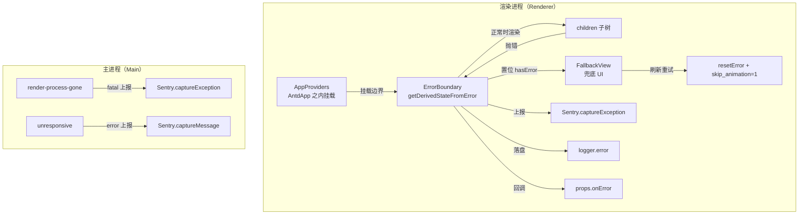

---

title: 错误边界（ErrorBoundary）
description: 接住渲染异常，兜底 UI + 三路上报 + 一键恢复。
---

# 错误边界（ErrorBoundary）

> **TL;DR**：接住渲染异常，兜底 UI + 三路上报 + 一键恢复。

- **本页负责**：渲染层 `ErrorBoundary` 子树捕获、三路上报（Sentry / 本地日志 / `onError`）与 `FallbackView` 带 `skip_animation=1` 的重载恢复。
- **本页不负责**：Sentry 初始化与采样开关见 [崩溃上报（Sentry）](/main/crash-reporting)；本地日志轮转与目录见 [本地日志](/main/logging)；跳过动画参数消费见 [首屏体验](/ui/first-screen)；Provider 嵌套见 [组件库（Antd）](/ui/antd)。

## 1. 选型理由

React 组件在渲染或生命周期中抛错若无边界接住，整棵树会被卸载导致 Electron 窗口白屏，且渲染异常未落盘时排查毫无依据；而 `render-process-gone` / `unresponsive` 等进程级故障则位于组件树管辖之外，必须由主进程代报。

本模板采用「类组件边界 + 三路上报 + 分进程兜底」：渲染树内由 `getDerivedStateFromError` 切入兜底 UI 并通过 `resetKey` 重挂子树，进程级崩溃交由主进程 `SentryModule` 监听。

官方参考：[React Error Boundaries（getDerivedStateFromError / componentDidCatch）](https://react.dev/reference/react/Component#catching-rendering-errors-with-an-error-boundary)（读它能明确两个生命周期的职责边界，以及事件处理器与异步回调为何不会被 ErrorBoundary 捕获）。

## 2. 核心机制



### 状态重置与子树替换

`ErrorBoundary` 挂在 `AppProviders` 的 `<AntdApp>` 之内、包裹整棵 `App` 树；出错时切为 `FallbackView`，恢复时通过自增 `resetKey` 强制重挂子树：

→ 源码：[packages/renderer/src/components/layout/ErrorBoundary/index.tsx](https://github.com/BanShan-Alec/electron-react-monorepo-template/blob/main/packages/renderer/src/components/layout/ErrorBoundary/index.tsx)

```tsx
// 节选：ErrorBoundary 状态派生、重挂复位与 render 分支（省略 constructor 与 componentDidCatch）
  static getDerivedStateFromError(error: unknown): Partial<ErrorBoundaryState> {
    return { hasError: true, error };
  }

  resetError = (): void => {
    this.setState((prev) => ({ hasError: false, error: null, resetKey: prev.resetKey + 1 }));
  };

  render(): ReactNode {
    if (this.state.hasError) {
      return <FallbackView error={this.state.error} resetError={this.resetError} />;
    }
    return <Fragment key={this.state.resetKey}>{this.props.children}</Fragment>;
  }
```

### 三路上报：Sentry、落盘日志与业务回调

`componentDidCatch` 顺序执行 Sentry 上报、取 `componentStack` 首帧组件名落盘 `logger.error`，并触发可选 `onError` 回调：

→ 源码：[packages/renderer/src/components/layout/ErrorBoundary/index.tsx](https://github.com/BanShan-Alec/electron-react-monorepo-template/blob/main/packages/renderer/src/components/layout/ErrorBoundary/index.tsx)

```tsx
// 节选：componentDidCatch 三路上报（Sentry 完整标签构造略）
  componentDidCatch(error: Error, errorInfo: ErrorInfo): void {
    Sentry.captureException(error, {
      tags: buildSentryTags(APP_FEATURES.RENDERER_HOME, {
        [SENTRY_TAGS.LOGGER]: this.constructor.name,
        [SENTRY_TAGS.PROCESS]: 'renderer',
      }),
      extra: { componentStack: errorInfo.componentStack },
    });

    // Sentry 未激活（dev / 无 DSN）时这是渲染崩溃的唯一磁盘痕迹
    const crashedComponent =
      /^\s*at\s+([A-Za-z0-9_$]+)/m.exec(errorInfo.componentStack ?? '')?.[1] ?? 'unknown';
    logger.error(`React component crashed in <${crashedComponent}>:`, error, {
      componentStack: errorInfo.componentStack,
    });

    this.props.onError?.(error, errorInfo);
  }
```

### 兜底 UI 与跳过动画重载

`FallbackView` 在开发态展示错误详情、生产态只显示通用提示；「刷新重试」先调 `resetError()`，再向 URL 注入 `skip_animation=1` 后 `location.replace`，放行启动协调器动画门禁：

→ 源码：[packages/renderer/src/components/layout/ErrorBoundary/index.tsx](https://github.com/BanShan-Alec/electron-react-monorepo-template/blob/main/packages/renderer/src/components/layout/ErrorBoundary/index.tsx)

```tsx
// 节选：dev 错误显隐判断与 skip_animation=1 重载恢复（JSX 布局略）
const isDev = window.__APP_ENV__?.mode === APP_ENV.DEVELOPMENT || import.meta.env.DEV;
const errorMessage = error instanceof Error ? error.message : String(error || '');

const handleReload = (): void => {
  if (resetError) {
    resetError();
  }
  const url = new URL(window.location.href);
  url.searchParams.set('skip_animation', '1');
  window.location.replace(url.toString());
};
```

## 3. 桌面端避坑注意事项

- **进程级故障由主进程 `SentryModule` 独立监听**：`SentryModule.enable` 仅在 `isSentryEnabled()`（已打包且存在 DSN）时注册 `render-process-gone`（`fatal`）与 `unresponsive`（`error`），dev 环境不挂载；`render-process-gone` 会先写 `logger.error`，遇到 `appLifecycle.isQuitting` 或 `clean-exit` 再跳过上报（见 [崩溃上报](/main/crash-reporting)）。
- **Sentry 未激活时依赖本地日志排障**：dev 或无 DSN 环境下组件异常只留在 `renderer-<window>.log`，主进程未捕获异常由 `LogManager` 的 `errorHandler.startCatching({ showDialog: false })` 静默落盘（见 [本地日志](/main/logging)）。
- **必须挂在 `AntdApp` 与 `I18nProvider` 之内**：否则 `FallbackView` 内的 `Empty`、`Button` 与 `t` 宏拿不到主题与语言上下文；全局边界已由 `AppProviders` 统一挂载，局部页面隔离可直接套用 `<ErrorBoundary onError={...}>`（修改兜底文案后需执行 `pnpm i18n:extract`）。
