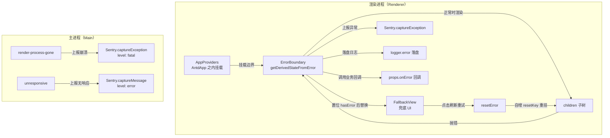

---

title: 错误边界（ErrorBoundary）
description: 接住渲染异常，兜底 UI + 三路上报 + 一键恢复。
---

# 错误边界（ErrorBoundary）

> **TL;DR**：接住渲染异常，兜底 UI + 三路上报 + 一键恢复。

## 1. 选型理由

React 组件在渲染或生命周期里抛异常，如果没有边界接住，整棵组件树会被卸载——Electron 窗口里就剩一片空白，用户只能强退。更麻烦的是排障：渲染层的异常如果不落盘，主进程日志里找不到任何痕迹，用户能提供的只有「点了一下就白了」。

进程级故障又在组件树管辖之外：渲染进程整个崩掉时页面自己报不了，只能由主进程代报；主进程自己的未捕获异常也需要独立的落盘通道。

所以这里选的是「类组件 + 三路上报 + 分进程兜底」：组件树内用 `getDerivedStateFromError` 接住并把整棵子树替换成兜底 UI，上报同时走 Sentry、落盘与业务回调；进程级崩溃交给主进程的 `render-process-gone` / `unresponsive` 监听。

## 2. 核心机制



图中不画跨进程边：组件树里的异常由 `ErrorBoundary` 接住，`render-process-gone` 与 `unresponsive` 是 Electron 的进程/窗口事件、由主进程独立监听，二者与组件异常没有因果关系。

### 类组件接住子树异常，fallback 替换整棵子树

`ErrorBoundary` 是类组件：`getDerivedStateFromError` 只做一件事——把 `hasError` 置位并记下 `error`；`render` 在出错时用 `FallbackView` 替换整个子树，未出错时用 `resetKey` 作为 `Fragment` 的 key。恢复走 `resetError`：自增 `resetKey` 让 children 以新 key 重新挂载，不需要整页刷新。

→ 源码：[packages/renderer/src/components/layout/ErrorBoundary/index.tsx](https://github.com/BanShan-Alec/electron-react-monorepo-template/blob/main/packages/renderer/src/components/layout/ErrorBoundary/index.tsx)

节选：`ErrorBoundary` 类（省略 `componentDidCatch`，见下节）：

```tsx
export class ErrorBoundary extends Component<ErrorBoundaryProps, ErrorBoundaryState> {
  constructor(props: ErrorBoundaryProps) {
    super(props);
    this.state = {
      hasError: false,
      error: null,
      resetKey: 0,
    };
  }

  static getDerivedStateFromError(error: unknown): Partial<ErrorBoundaryState> {
    return {
      hasError: true,
      error,
    };
  }

  resetError = (): void => {
    this.setState((prev) => ({
      hasError: false,
      error: null,
      resetKey: prev.resetKey + 1,
    }));
  };

  render(): ReactNode {
    if (this.state.hasError) {
      return <FallbackView error={this.state.error} resetError={this.resetError} />;
    }
    return <Fragment key={this.state.resetKey}>{this.props.children}</Fragment>;
  }
}
```

### 三路上报：Sentry、落盘日志、业务回调

`componentDidCatch` 拿到 `error` 与 `componentStack`，按顺序做三件事：Sentry 上报（附带组件栈）；`logger.error` 落盘；最后调用可选的 `onError` 回调。落盘行里的组件名取 `componentStack` 首帧，不用翻长栈定位。

节选（同文件的 `componentDidCatch`，状态推导与恢复逻辑见上一段）：

→ 源码：[packages/renderer/src/components/layout/ErrorBoundary/index.tsx](https://github.com/BanShan-Alec/electron-react-monorepo-template/blob/main/packages/renderer/src/components/layout/ErrorBoundary/index.tsx)

```tsx
  componentDidCatch(error: Error, errorInfo: ErrorInfo): void {
    // 1. 渲染进程崩溃捕获并上报至 Sentry
    Sentry.captureException(error, {
      tags: buildSentryTags(APP_FEATURES.RENDERER_HOME, {
        [SENTRY_TAGS.LOGGER]: this.constructor.name,
        [SENTRY_TAGS.PROCESS]: 'renderer',
      }),
      extra: {
        componentStack: errorInfo.componentStack,
      },
    });

    // 2. 落盘：Sentry 未激活（dev/无 DSN）时这是渲染崩溃的唯一磁盘痕迹；
    //    组件名取 componentStack 首帧（即崩溃组件本身），免翻长栈定位
    const crashedComponent =
      /^\s*at\s+([A-Za-z0-9_$]+)/m.exec(errorInfo.componentStack ?? '')?.[1] ?? 'unknown';
    logger.error(`React component crashed in <${crashedComponent}>:`, error, {
      componentStack: errorInfo.componentStack,
    });

    // 3. 执行外部业务传入的 onError 回调
    this.props.onError?.(error, errorInfo);
  }
```

### 兜底 UI：dev 才显示错误信息，一键带跳过动画重载

兜底是一张固定定位的全屏层（`fixed inset-0 z-50`），内容用 antd 的 `Empty` + `Button`。错误详情只在开发态出现，生产只显示一句「页面出错啦~」。

边界在 `AppProviders` 里挂在 `AntdApp` 与 `ConfigProvider` 之内，再往上是 `StyleProvider`、`I18nProvider`（见[组件库（Antd）](/ui/antd)）。位置决定能力：`FallbackView` 里的 `Empty`、`Button` 能拿到 antd 主题与语言包，`t\`页面出错啦~\``能拿到 Lingui 实例。边界包住的是`AppProviders`的`children`，即 `Router`与整棵`App` 树（见[路由（Wouter）](/ui/wouter)）。

→ 源码：[packages/renderer/src/components/layout/ErrorBoundary/index.tsx](https://github.com/BanShan-Alec/electron-react-monorepo-template/blob/main/packages/renderer/src/components/layout/ErrorBoundary/index.tsx)

```tsx
function FallbackView({ error, resetError }: FallbackProps) {
  useLingui();
  const isDev = window.__APP_ENV__?.mode === APP_ENV.DEVELOPMENT || import.meta.env.DEV;
  const errorMessage = error instanceof Error ? error.message : String(error || '');

  const description = (
    <div className="flex flex-col items-center gap-2">
      <span className="text-base font-medium text-foreground">{t`页面出错啦~`}</span>
      {isDev && errorMessage ? (
        <span className="text-xs text-foreground-secondary font-mono max-w-lg break-all text-center">
          {errorMessage}
        </span>
      ) : null}
    </div>
  );

  const handleReload = (): void => {
    if (resetError) {
      resetError();
    }
    const url = new URL(window.location.href);
    url.searchParams.set('skip_animation', '1');
    window.location.replace(url.toString());
  };

  return (
    <div className="fixed inset-0 z-50 flex flex-col items-center justify-center gap-6 p-6 bg-background text-foreground">
      <Empty image={Empty.PRESENTED_IMAGE_DEFAULT} description={description} />
      <Button type="primary" onClick={handleReload}>
        {t`刷新重试`}
      </Button>
    </div>
  );
}
```

「刷新重试」先调 `resetError()` 重挂子树，再给当前 URL 加上 `skip_animation=1` 后 `location.replace`——启动协调器读到这个参数会直接放行动画门禁（见[首屏体验（Startup-orchestration）](/ui/first-screen)），重载不再重放 Logo 动画。

## 3. 桌面端避坑注意事项

- **渲染层异常与进程级崩溃是两套通道**：组件树里的异常归 `ErrorBoundary`；`render-process-gone` 与窗口 `unresponsive` 由主进程的 `SentryModule` 监听上报（`packages/main/src/modules/sentry.module.ts`），崩溃走 `captureException` + `level: 'fatal'` 并附崩溃原因与退出码，无响应走 `captureMessage` + `level: 'error'` 并附当前 URL。进程都没了，渲染层自己报不了，只能主进程代报。
- **这两个监听只在 Sentry 启用时注册**：`SentryModule.enable` 在 `!isSentryEnabled()`（未打包或无 DSN）时直接 return，dev 下连监听都不会挂，进程级崩溃不会留下任何上报。
- **正常退出仍写日志，只跳过 Sentry**：`render-process-gone` 的处理器先执行 `logger.error('Renderer process gone unexpectedly:', details)`，再在 `appLifecycle.isQuitting` 或 `details.reason === 'clean-exit'` 时返回；正常退出会留下一条 `unexpectedly` 日志，只是不再上报。
- **Sentry 未激活时组件异常只剩落盘**：dev 或无 DSN 时 `Sentry.captureException` 不会上报，`ErrorBoundary` 里的 `logger.error` 写入的 `renderer-<window>.log` 是渲染层异常的磁盘痕迹；此时进程级事件连监听都没注册（见上条），不能指望它有上报。
- **主进程未捕获异常独立落盘**：由 electron-log 的 `errorHandler.startCatching({ showDialog: false })` 接管（`packages/main/src/modules/log.module.ts`），只写日志不弹对话框，避免后台常驻时用系统弹窗打断用户。
- **重载不重放启动动画**：兜底层的重载 URL 带 `skip_animation=1`，启动协调器据此直接放行动画门禁。
- **重置靠重挂而非刷新**：`resetError` 自增 `resetKey` 重挂 children，不需要整页刷新。
- **生产不暴露错误详情**：错误信息只在开发态渲染，生产只保留「页面出错啦~」与刷新按钮。

**给一个子树加兜底的落地步骤：**

1. **全局边界已经挂好**：`AppProviders` 里 `<AntdApp><ErrorBoundary>{children}</ErrorBoundary></AntdApp>` 包住了整棵 App 树，新页面不用再包。
2. **要额外动作就传 `onError`**：组件内部已先完成 Sentry 上报与 `logger.error` 落盘，回调里只写业务自己的逻辑；签名是 `onError?: (error: Error, errorInfo: ErrorInfo) => void`。
3. **隔离局部崩溃**：`ErrorBoundary` 无全局状态，可以在任意子树外再包一层；出错的子树被 `FallbackView` 替换，其余界面不受影响。
4. **改兜底文案**：改 `FallbackView` 里的 `t\`页面出错啦~\``与`t\`刷新重试\``，跑 `pnpm i18n:extract` 同步词条。
