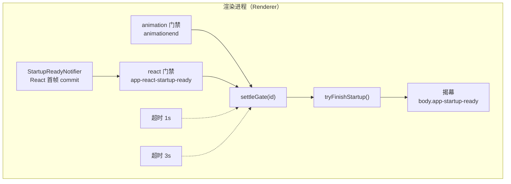

---

title: 首屏体验（Startup-orchestration）
description: 动画与 React 首帧两道门禁协调揭幕，内联启动壳顶住白屏空窗期。
---

import { StartupShellPreview } from '../../components/StartupShellPreview';

# 首屏体验（Startup-orchestration）

> **TL;DR**：React 挂载前由轻量内联 HTML 启动壳顶住白屏；构建内联的启动协调器（Coordinator）等待 Logo 动画与 React 首帧两道门禁齐备后交叉揭幕，任一路失联均有超时兜底。

<StartupShellPreview />

## 1. 选型理由

桌面应用从双击图标到首屏完全可交互，中间面临三重不确定性：
1. **白屏闪烁**：Chromium 渲染进程解析庞大 JS 产物时页面空白。
2. **时序割裂**：前端 React 已经渲染完成，但主进程的核心控制器或配置存储尚未就绪，导致用户点击触发空指针。
3. **死锁风险**：若强依赖某单一路就绪信号，一旦发生异常（如主进程 IPC 假死），应用将永久卡在 Loading 骨架屏。

传统社区实践常采用 `show: false` 配合 `ready-to-show` 事件再呈现窗口，但这会导致用户双击桌面图标后在数百毫秒内没有任何物理界面出现，产生严重的“假死未启动”迟滞感。本项目刻意采用**「窗口创建即显示 + 底色对齐 + 裸 DOM 启动壳即刻呈现」**，在首帧瞬间给用户即时视觉反馈，再由启动协调器进行两道门禁汇流与超时兜底。

## 2. 核心机制



协调器由构建期插件 `startup-shell` 打包为经典 IIFE 内联进 `index.html`，先于 React 执行。它维护门禁注册表：`pendingGates` 初始装齐 `animation` / `react`，每路就绪调用一次 `settleGate`；集合清空后由 `tryFinishStartup` 统一揭幕，`finished` 保证只执行一次。

### 关键实现：门禁结算与揭幕

→ 源码：[packages/renderer/plugins/startup/coordinator.ts](https://github.com/BanShan-Alec/electron-react-monorepo-template/blob/main/packages/renderer/plugins/startup/coordinator.ts)

节选：`coordinator.ts` 的门禁结算与揭幕函数（`finished` / `pendingGates` / `GateId` 为同文件模块级状态）：

```ts
const tryFinishStartup = () => {
  if (finished || pendingGates.size > 0) return;
  finished = true;
  document.body.classList.add(APP_STARTUP_READY_CLASS);
  window.setTimeout(
    () => document.getElementById(LOADING_ELEMENT_ID)?.remove(),
    STARTUP_UNMOUNT_DELAY_MS,
  );
};

const settleGate = (id: GateId) => {
  if (finished) return;
  pendingGates.delete(id);
  tryFinishStartup();
};
```

**为什么只有两道门禁**：主进程模块装配完成一度是第三道门禁，经 preload 的 `api.startup` 快照拉取 + 广播双保险接入。但它是跨进程的**代理信号**——「模块装配完成」并不等于「服务可用」，真正需要等待的业务就绪应放在业务层（例如拿到服务端口后再挂载业务根），不该由启动壳承担。这道门禁与 `api.startup` 契约已整体移除：壳只等动画与 React 首帧；装配耗时改由主进程 `app.initialization` span 记录（`initMs` 属性保留以进程启动为锚的总耗时），落 `traces.ndjson`——属于观测，不再是判断。

## 3. 桌面端避坑注意事项

- **首屏协调器与 CSP 生产策略协同**：
  - 启动协调器是构建期直接内联到 `index.html` 的独立原生脚本。主进程在配置生产态 CSP 时，`script-src` 必须包含 `'unsafe-inline'`（或匹配 hash），否则协调器会被 Chromium 静默阻断，导致两道门禁永远无法结算揭幕，造成应用与自动化测试无死锁假死。
- **产物冒烟严禁断言静态 `#root` 假阳性**：
  - 许多冒烟测试仅断言 HTML 包含 `<div id="root">` 便判定渲染成功，此时页面可能因 JS 语法错误处于彻底白屏。产物校验脚本必须等待 `page.waitForSelector('body.app-startup-ready')`，断言协调器真实完成揭幕。
- **两道门禁超时兜底单一真源**：
  - `STARTUP_ANIMATION_FALLBACK_MS`（1s）、`STARTUP_REACT_FALLBACK_MS`（3s）常量统一定义在 `@app/shared`，严禁在渲染端与 E2E 断言分别硬编码数字。主进程装配耗时不是门禁，由 `app.initialization` span 的 `initMs` 属性记录，排障时看 `traces.ndjson`。
- **裸 DOM 启动壳样式不引外部资源**：
  - 启动壳 CSS 必须直接内联在 HTML `<style>` 标签中，严禁引用外部字体或外链图片，确保在最慢的物理磁盘上也能在首帧瞬间呈现。
