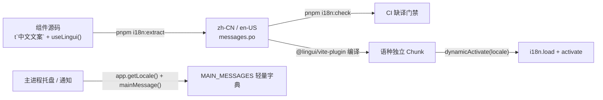

---

title: 国际化（i18n）
description: Lingui 中文源即 key、编译期抽取与按需加载，主进程原生文案与错误码本地化分层。
---

# 国际化（i18n）

> **TL;DR**：渲染层采用 Lingui 方案，组件内直接书写中文文案（Source-as-Key），构建期自动提取至 `.po` 词条文件；运行时按语种动态加载独立 Chunk；主进程不引入重型 i18n 运行时，原生菜单与通知由轻量映射函数分流。

- **本页负责**：LinguiJS Source-as-Key 机制、语言包按需动态加载、词条提取/缺译校验命令，以及主/渲染进程国际化分层。
- **本页不负责**：中英文案撰写规则（R1–R11）、长度预算、术语表与 Review 清单见 [国际化文案规范（Copy）](/ui/i18n-copy)；语言偏好跨进程持久化与同步见 [主题链路](/ui/theme-pipeline) 与 [配置持久化](/main/config-persistence)。

## 1. 选型理由

传统国际化方案（如手写 key 的 i18next）要求在编写界面前先定义英文标识符（如 `t('dashboard.counter.title')`）再维护 JSON：源码可读性差，且代码删除文案后极易在 JSON 中残留僵尸词条。

本工程采用 Lingui 达成**「中文即 Key、编译期自动提取与清扫、按语种拆分产物按需加载」**。

官方参考：[LinguiJS React 与宏指南](https://lingui.dev/tutorials/react)（读它能理解 `@lingui/core/macro` 编译期 AST 提取、ICU 复数语法以及 `useLingui` / `I18nProvider` 的运行时订阅机制）。

## 2. 核心机制



### 源码即 Key 与组件订阅

在 JSX 中直接书写中文并使用 `@lingui/core/macro` 的 `t` 宏标记，组件首行显式调用 `useLingui()` 订阅语言上下文切换：

→ 源码：[packages/renderer/src/features/counter/components/CounterCard/index.tsx](https://github.com/BanShan-Alec/electron-react-monorepo-template/blob/main/packages/renderer/src/features/counter/components/CounterCard/index.tsx)

```tsx
// 节选：订阅语种变更并在 JSX 中直接书写中文源文案
const _CounterCard = (props: CounterCardProps) => {
  useLingui();
  const { count, step, onStepChange, isUpdating, onIncrement, onDecrement, onReset } = props;

  return (
    <AppCard
      title={
        <CardTitle
          icon={<CalculatorOutlined />}
          title={t`IPC 计数器 (Counter)`}
          subtitle={t`基于主进程状态原子操作与响应式更新`}
        />
      }
    >
      {/* ... 省略计数展示与步长选择 ... */}
      <Button size="small" icon={<RedoOutlined />} loading={isUpdating} onClick={onReset}>
        {t`重置为 0`}
      </Button>
    </AppCard>
  );
};
```

### 运行时按需动态加载 Chunk

`@lingui/vite-plugin` 在编译期将 `.po` 词条转为 JS 模块，`dynamicActivate` 按当前解析出的 `SupportedLocale` 动态 `import` 对应语种并更新 `<html lang>`：

→ 源码：[packages/renderer/src/locales/i18n.ts](https://github.com/BanShan-Alec/electron-react-monorepo-template/blob/main/packages/renderer/src/locales/i18n.ts)

```ts
export async function dynamicActivate(locale: SupportedLocale): Promise<void> {
  if (locale === 'en-US') {
    // @ts-expect-error .po format is transformed by @lingui/vite-plugin at build time
    const { messages } = await import('./en-US/messages.po');
    i18n.load('en-US', messages);
  } else {
    // @ts-expect-error .po format is transformed by @lingui/vite-plugin at build time
    const { messages } = await import('./zh-CN/messages.po');
    i18n.load('zh-CN', messages);
  }

  i18n.activate(locale);

  if (typeof document !== 'undefined') {
    document.documentElement.lang = locale;
  }
}
```

### 词条提取与自动化校验命令

→ 源码：[package.json](https://github.com/BanShan-Alec/electron-react-monorepo-template/blob/main/package.json)

```bash
pnpm i18n:extract    # lingui extract --clean：扫描源码抽取词条并清理废弃条目
pnpm i18n:check      # lingui check missing：CI 门禁，存在漏翻词条（空 msgstr）立即非零退出
```

## 3. 桌面端避坑注意事项

- **主进程严禁引入完整 Lingui 运行时**：主进程仅有系统托盘菜单与桌面通知需要本地化，引入 Lingui 会将词条与运行时打进主进程包体。主进程统一通过 [packages/main/src/i18n.ts](https://github.com/BanShan-Alec/electron-react-monorepo-template/blob/main/packages/main/src/i18n.ts) 的 `mainMessage(mode, key)` 结合 `app.getLocale()` 派发文案。
- **错误提示文案的两层分工**：主进程只返回结构化英文诊断与 `ErrorCode`（日志统一英文）；面向用户的本土化提示完全由渲染进程按 `ErrorCode` 翻译，杜绝中英混杂。
- **英文文案长度与排版约束不在本页维护**：英文短语长度通常高于中文，涉及按钮、卡片标题等窄槽位的长度预算与撰写规范见 [国际化文案规范（Copy）](/ui/i18n-copy)。
