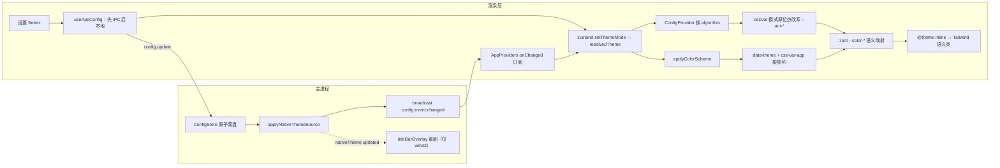

---

title: 主题链路（Theme Pipeline）
description: 一次主题切换从设置项到每个像素的完整传播：主进程持久化、双通道收敛、cssVar 热改写与原生窗口同步。
---

# 主题链路（Theme Pipeline）

> **TL;DR**：主题切换是跨进程全链路事件——持久化唯一归属主进程 ConfigStore，渲染层经「本地回填 + 广播订阅」双通道收敛进 zustand，`resolvedTheme` 同时驱动 antd 算法热改写 `--ant-*` 与 `data-theme` 根契约；首帧主题由窗口创建链经 URL query 显式传入，不依赖模块装配顺序。

- **本页负责**：主题偏好从设置项到主进程落盘、跨窗口广播、首帧防闪烁及 `nativeTheme` 原生窗口同步的完整传播链路。
- **本页不负责**：静态色阶派生与三层映射规则见 [设计规范与令牌](/ui/design-tokens)；Provider 嵌套见 [组件库（Antd）](/ui/antd)；Store 订阅约束见 [全局状态（Zustand）](/ui/zustand)；配置存储与自愈见 [配置持久化](/main/config-persistence)；WCO 颜色配置见 [原生窗口体验（WCO）](/ui/wco)。

## 1. 选型理由

把「切主题」当成渲染层局部 `setState`，在桌面端会出现四类典型故障：**刷新或第二窗口丢主题**（持久化出现第二真源）、**antd 组件色板不跟手或 Portal 浮层掉色**、**首帧白闪或串色**（窗口底色、标题栏与 React 首帧各自猜测 `prefers-color-scheme`），以及**win32 标题栏 overlay 与页面明暗割裂**。

本模板把四类问题收敛成一条显式链路：**持久化单一归属主进程，渲染层只持有派生状态，首帧由主进程显式传参**。

官方参考：[Electron nativeTheme API](https://www.electronjs.org/docs/latest/api/native-theme)（读它能明确 `nativeTheme.themeSource` 与 `shouldUseDarkColors` 的主进程解析契约，以及 OS 主题变更事件 `updated` 的触发边界）。

## 2. 核心机制



### 所有权分层：themeMode 与 resolvedTheme

→ 源码：[packages/renderer/src/stores/useAppStore.ts](https://github.com/BanShan-Alec/electron-react-monorepo-template/blob/main/packages/renderer/src/stores/useAppStore.ts)

zustand 只持有运行态并拆成两层：`themeMode` 是用户偏好三态（`'system' | 'light' | 'dark'`），`resolvedTheme` 是即时解析后的具体明暗（`'light' | 'dark'`）。持久化唯一归属主进程 ConfigStore（见 [配置持久化](/main/config-persistence)），渲染层刷新后靠 `config.get` 重建。

### 传播：先落盘，再广播，双通道收敛

→ 源码：[packages/renderer/src/components/layout/AppProviders/index.tsx](https://github.com/BanShan-Alec/electron-react-monorepo-template/blob/main/packages/renderer/src/components/layout/AppProviders/index.tsx)

设置项更新走「先 IPC 成功，再本地回填」（`useAppConfig.handleUpdateConfig`），不做乐观更新。主进程在 `config.update` 内原子落盘、同步 `nativeTheme.themeSource`，随后 `broadcast(config:event:changed)`，使发起窗口与托盘、配置重置等旁路修改都经 `AppProviders` 收敛到同一个 `setThemeMode`：

```tsx
// 节选：初始拉取与跨窗口同步（JSX 装配省略）
useEffect(() => {
  callIpc('config.get')
    .then((data) => {
      if (data.theme) setThemeMode(data.theme);
      if (data.language) setLanguage(data.language);
    })
    .catch(() => {});

  const unsubscribe = window.api?.config?.onChanged?.((config) => {
    if (config.theme) setThemeMode(config.theme);
    if (config.language) setLanguage(config.language);
  });

  return () => {
    unsubscribe?.();
  };
}, [setThemeMode, setLanguage]);
```

### 双消费者：算法热改写与根契约

→ 源码：[packages/renderer/src/hooks/useTheme.ts](https://github.com/BanShan-Alec/electron-react-monorepo-template/blob/main/packages/renderer/src/hooks/useTheme.ts)

`resolvedTheme` 变化并行驱动两端：`ConfigProvider` 切换 algorithm 后由 cssinjs 原位改写 `--ant-*`；`useTheme` 调用 `applyColorScheme(resolvedTheme)` 幂等挂载 `data-theme` 与 `css-var-app` 至 `<html>`，并在 `themeMode === 'system'` 时监听 `matchMedia` 跟随系统翻转：

```ts
// 节选：useTheme 挂根契约与 system 模式的 OS 监听
export function useTheme() {
  const themeMode = useAppStore((state) => state.themeMode);
  const resolvedTheme = useAppStore((state) => state.resolvedTheme);
  const setThemeMode = useAppStore((state) => state.setThemeMode);

  useEffect(() => {
    applyColorScheme(resolvedTheme);
  }, [resolvedTheme]);

  useEffect(() => {
    if (themeMode !== 'system') return;
    const mediaQuery = window.matchMedia(LIGHT_COLOR_SCHEME_QUERY);
    const handleChange = () => setThemeMode('system');
    mediaQuery.addEventListener('change', handleChange);
    return () => mediaQuery.removeEventListener('change', handleChange);
  }, [themeMode, setThemeMode]);
}
```

### 首帧链与原生侧联动

→ 源码：[packages/main/src/modules/window/home-window.module.ts](https://github.com/BanShan-Alec/electron-react-monorepo-template/blob/main/packages/main/src/modules/window/home-window.module.ts)

窗口创建时由 `resolveNativeTheme()` 同步 `nativeTheme.themeSource` 并解析具体明暗，`backgroundColor`、win32 WCO overlay 与 `loadFile/loadURL` 携带的 `?theme=light|dark` query（`STARTUP_THEME_QUERY_KEY`）均消费同一结果。两个渲染入口（home / updater）在首行内联脚本中读取 query 预置 `data-theme`，刻意不读 `prefers-color-scheme`，彻底避免首帧闪烁。

→ 源码：[packages/renderer/src/entries/updater/index.html](https://github.com/BanShan-Alec/electron-react-monorepo-template/blob/main/packages/renderer/src/entries/updater/index.html)

```html
<script>
  // 首帧主题由主进程经 URL query 显式传入，不读 prefers-color-scheme
  const startupTheme = new URLSearchParams(window.location.search).get('theme');
  if (startupTheme === 'dark' || startupTheme === 'light') {
    document.documentElement.dataset.theme = startupTheme;
  }
</script>
```

原生侧仅在 `nativeTheme` 的 `updated` 事件触发 `applyTitleBarOverlay()` 重刷 win32 主窗口标题栏（见 [native-theme.module.ts](https://github.com/BanShan-Alec/electron-react-monorepo-template/blob/main/packages/main/src/modules/native-theme.module.ts)）；`backgroundColor` 构造后不变，也不向渲染层转发 `updated` 事件。

### 改动落点判据

- **换品牌色**：只改 [design-tokens.ts](https://github.com/BanShan-Alec/electron-react-monorepo-template/blob/main/packages/renderer/src/styles/design-tokens.ts) 的 `BRAND_PRIMARY` 一处；改后同步更新 `e2e/settings.spec.ts` 主色断言（当前浅色 `#1677ff` / 深色 `#1668dc`）并跑通。
- **新增语义 token**：按 `index.css` 的 `:root` 纯改名映射 → `@theme inline` 别名 → 组件 Tailwind 语义类三步落地，确认 `design-tokens.test.ts` 与 `pnpm verify:prebuild` 全绿。

## 3. 桌面端避坑注意事项

- **持久化单一归属主进程**：zustand 不启用 persist 中间件，渲染层严禁再存一份本地副本，否则多窗口状态必然冲突。
- **先 IPC 成功再本地回填**：避免落盘失败时界面闪回；本地回填与广播幂等触发同一 setter，无需额外去重。
- **`nativeTheme 'updated'` 不通知渲染层**：OS 翻转仅在 `system` 模式经 Chromium `matchMedia` 感知，手动浅色/深色不跟随系统。
- **WCO overlay 仅 win32 运行时刷新**：darwin 的 overlay 仅启用 CSS `env()` 避让；React 根须保持不透明满幅，防止原生 `backgroundColor` 透出。
- **首帧正确性锚在窗口创建链而非模块顺序**：`resolveNativeTheme` 一次解析供三处消费，调整模块装配顺序不会产生串色。
