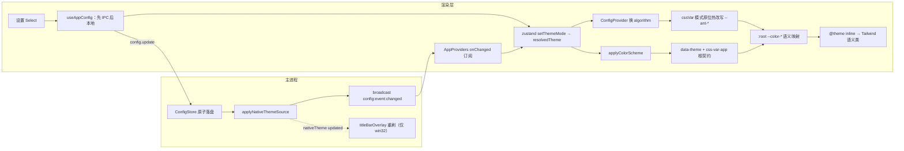

---

title: 主题链路（Theme Pipeline）
description: 一次主题切换从设置项到每个像素的完整传播：主进程持久化、双通道收敛、cssVar 热改写与原生窗口同步。
---

# 主题链路（Theme Pipeline）

> **TL;DR**：主题切换是跨进程全链路事件——持久化唯一归属主进程 ConfigStore，渲染层经「本地回填 + 广播订阅」双通道收敛进 zustand，`resolvedTheme` 同时驱动 antd 算法热改写 `--ant-*` 与 `data-theme` 根契约；首帧主题由窗口创建链经 URL query 显式传入，不依赖模块装配顺序。

## 1. 选型理由

把「切主题」当一句 `setState` 处理，在桌面端会以四种方式翻车：

1. **刷新或第二窗口丢主题**：状态只活在渲染层内存里；持久化一旦出现第二真源，两个窗口迟早各显示各的。
2. **antd 组件不跟手**：组件库的明暗由算法（algorithm）派生，只改 CSS 类改不动它的内部色板；Portal 浮层还可能脱离变量作用域掉色。
3. **首帧白闪或串色**：窗口底色、标题栏、React 首帧若各自猜主题（各读一次 `prefers-color-scheme`），任何一次猜错就是可见闪烁。
4. **原生侧割裂**：win32 标题栏 overlay 不随主题刷新时，页面已变深、标题栏仍是白。

本模板把四类问题收敛成一条显式链路：**持久化单一归属主进程，渲染层只持有派生状态，首帧由主进程显式传参**。静态的令牌定义与三层映射见 [设计规范与令牌](/ui/design-tokens)，本页只讲「切换」如何传播。

## 2. 核心机制



一次切换从设置项出发，经主进程落盘与广播回到渲染层双通道收敛，最后分两路生效（antd 算法 + 根契约），汇入静态消费链落到像素。

### 所有权分层：themeMode 与 resolvedTheme

→ 源码：[packages/renderer/src/stores/useAppStore.ts](https://github.com/BanShan-Alec/electron-react-monorepo-template/blob/main/packages/renderer/src/stores/useAppStore.ts)

zustand 只持有运行态，且拆成两层：`themeMode` 是用户偏好三态（跟随系统/浅色/深色），`resolvedTheme` 是解析后的具体明暗。`system` 在消费时即时解析——`matchMedia` 查询 `prefers-color-scheme` 命中为浅色、否则深色。落盘不在这里：持久化唯一归属主进程 ConfigStore（见 [配置持久化](/main/config-persistence)），渲染层刷新后靠 `config.get` 重建。

### 传播：先落盘，再广播，双通道收敛

→ 源码：[packages/renderer/src/components/layout/AppProviders/index.tsx](https://github.com/BanShan-Alec/electron-react-monorepo-template/blob/main/packages/renderer/src/components/layout/AppProviders/index.tsx)

设置项更新走「先 IPC 成功，再本地回填」（`useAppConfig.handleUpdateConfig`），不做乐观更新——落盘失败时界面不会闪回。主进程在 `config.update` 里原子落盘、同步 `nativeTheme.themeSource`，随后 `broadcast(config:event:changed)`；包括发起窗口在内的所有渲染层实例经 AppProviders 的订阅收敛到**同一个** `setThemeMode`，托盘、配置重置等旁路修改也因此自动回流。节选：

```tsx
// 节选：初始拉取与跨窗口同步（语言处理一并保留；JSX 装配省略）
useEffect(() => {
  // 拉取失败由 callIpc 统一落盘，主题/语言静默回落默认值（启动兜底不打扰，日志是唯一痕迹）
  callIpc('config.get')
    .then((data) => {
      if (data.theme) setThemeMode(data.theme);
      if (data.language) setLanguage(data.language);
    })
    .catch(() => {});

  const unsubscribe = window.api?.config?.onChanged?.((config) => {
    if (config.theme) setThemeMode(config.theme);
    if (config.language) setLanguage(config.language);
  });

  return () => {
    unsubscribe?.();
  };
}, [setThemeMode, setLanguage]);
```

### 双消费者：算法热改写与根契约

`resolvedTheme` 变化触发两个消费端并发生效：

- **antd 侧**：`ConfigProvider` 的 `theme={getAntdThemeConfig(resolvedTheme)}` 换 algorithm。因启用了 `cssVar`（key 即 `.css-var-app` 类名，配置细节见 [设计规范与令牌](/ui/design-tokens)），cssinjs 会**原位改写**作用域内 `--ant-*` 变量值——没有 reload、没有自定义事件，这是 antd cssVar 模式的内置能力。
- **DOM 侧**：`applyColorScheme(resolvedTheme)` 幂等挂两个根契约——`data-theme` 驱动 tokens.css 的 `color-scheme` 与滚动条/语法高亮深色变量，`css-var-app` 保证 `--ant-*` 可解析（必须挂 `<html>`，Portal 浮层才继承）。

→ 源码：[packages/renderer/src/hooks/useTheme.ts](https://github.com/BanShan-Alec/electron-react-monorepo-template/blob/main/packages/renderer/src/hooks/useTheme.ts)

`system` 模式下由 useTheme 挂 matchMedia 监听跟随 OS：回调借 `setThemeMode('system')` 走同一个 setter 重新解析；手动浅色/深色则不挂监听，OS 翻转不影响界面：

```ts
export function useTheme() {
  const themeMode = useAppStore((state) => state.themeMode);
  const resolvedTheme = useAppStore((state) => state.resolvedTheme);
  const setThemeMode = useAppStore((state) => state.setThemeMode);

  // 组件Effect
  useEffect(() => {
    applyColorScheme(resolvedTheme);
  }, [resolvedTheme]);

  useEffect(() => {
    if (themeMode !== 'system') {
      return;
    }
    const mediaQuery = window.matchMedia(LIGHT_COLOR_SCHEME_QUERY);
    const handleChange = () => {
      setThemeMode('system');
    };
    mediaQuery.addEventListener('change', handleChange);
    return () => {
      mediaQuery.removeEventListener('change', handleChange);
    };
  }, [themeMode, setThemeMode]);
}
```

### 静态消费链（详见既有页）

`--ant-*` → `:root` 15 个语义别名 `--color-*`（纯改名，无亮暗分支——明暗差异全部由算法承担）→ `@theme inline` 映射 → `bg-background`、`text-foreground` 等语义工具类。三层映射的完整规则、`inline` 自引用陷阱与「不写 fallback」决策见 [设计规范与令牌](/ui/design-tokens)。

### 首帧链：窗口创建时显式传参

→ 源码：[packages/main/src/modules/window/index.module.ts](https://github.com/BanShan-Alec/electron-react-monorepo-template/blob/main/packages/main/src/modules/window/index.module.ts)

首帧不靠模块装配顺序，也不靠渲染层猜测：创建窗口时读持久偏好 → `resolveNativeTheme()` 幂等同步 `nativeTheme.themeSource` 并解析出具体明暗 → `backgroundColor` 与 win32 WCO overlay 构造项用同一解析值 → `loadFile/loadURL` 携带 `?theme=light|dark` query（键为 shared 的 `STARTUP_THEME_QUERY_KEY`）。两个入口（home / updater）用同一段内联脚本消费 query 预置 `data-theme`——**刻意不读 `prefers-color-scheme`**，杜绝与持久偏好不一致时的闪烁；entry tsx 在 React 挂载前幂等 re-assert 并提前挂 `css-var-app`。此后 `config.get` 回填持久值，交给运行时链路接管。

→ 源码：[packages/renderer/src/entries/updater/index.html](https://github.com/BanShan-Alec/electron-react-monorepo-template/blob/main/packages/renderer/src/entries/updater/index.html)

```html
<script>
  // 首帧主题由主进程经 URL query 显式传入（window 模块 resolveNativeTheme → shared STARTUP_THEME_QUERY_KEY）。
  // 不读 prefers-color-scheme：system 模式的运行时变化由 useTheme 的 matchMedia 监听负责。
  const startupTheme = new URLSearchParams(window.location.search).get('theme');
  if (startupTheme === 'dark' || startupTheme === 'light') {
    document.documentElement.dataset.theme = startupTheme;
  }
</script>
```

### 原生侧联动与边界

→ 源码：[packages/main/src/modules/native-theme.module.ts](https://github.com/BanShan-Alec/electron-react-monorepo-template/blob/main/packages/main/src/modules/native-theme.module.ts)

- **有联动**：`nativeTheme` 的 `updated` 事件触发 `applyTitleBarOverlay()` 重刷主窗口标题栏，仅 win32 生效（平台限制见 [原生窗口体验](/ui/wco)）；颜色单一真源在 `titlebar-overlay.ts` 的深浅两分支。
- **明确不联动**：`backgroundColor` 构造后运行时不更新——渲染层恒透明、React 根不透明满幅，原生底色不可见故无需更新；托盘图标无主题变体；`updated` 不通知渲染层——OS 明暗翻转的感知只有 `system` 模式经 Chromium 自动更新 `prefers-color-scheme` 一条路。

### 改动落点判据

- **换品牌色**：只改 [design-tokens.ts](https://github.com/BanShan-Alec/electron-react-monorepo-template/blob/main/packages/renderer/src/styles/design-tokens.ts) 的 `BRAND_PRIMARY` 一处，色阶由算法全量派生。完成判据：改后 `e2e/settings.spec.ts` 的主色断言（浅色 `#1677ff` / 深色 `#1668dc`）同步更新且通过。
- **新增语义 token**：过三关——`index.css` 的 `:root` 加一条 `--color-*` 纯改名映射 → `@theme inline` 加语义别名 → 组件用 Tailwind 语义类消费（直读 `--ant-*` 会被 `pnpm verify:prebuild` 静态拦截）。完成判据：`design-tokens.test.ts` 的「两套算法 CSS 覆盖所有引用」断言仍绿。

## 3. 桌面端避坑注意事项

- **持久化单一归属主进程**：zustand 不用 persist 中间件，刷新/重开窗口靠 `config.get` 重建。渲染层任何「顺手存一份」都会制造第二真源，双窗口立刻打架。
- **先 IPC 成功再本地回填**：乐观更新在落盘失败时会闪回原主题。双通道下本地回填与广播会各 `set` 一次，同值幂等无抖动，不必再去重。
- **`nativeTheme 'updated'` 不通知渲染层**：不要为主进程主题变化另搭渲染层监听桥；OS 翻转感知只走 `system` 模式的 matchMedia 一条路，手动浅色/深色本就不该跟系统变。
- **WCO overlay 仅 win32 运行时刷新**：darwin 的 overlay 只用于启用 CSS env 避让，颜色由系统管理；`backgroundColor` 构造后不可变，靠「渲染层恒透明 + React 根不透明满幅」让原生底色永不露脸——React 根出现透明缝隙时原生底色会直接透出。
- **首帧正确性锚在窗口创建链，不锚模块顺序**：模块 enable 顺序是装配细节；主题解析只发生一次（`resolveNativeTheme`），backgroundColor、overlay、query 三处消费同一结果，调整装配顺序不会引入串色。
