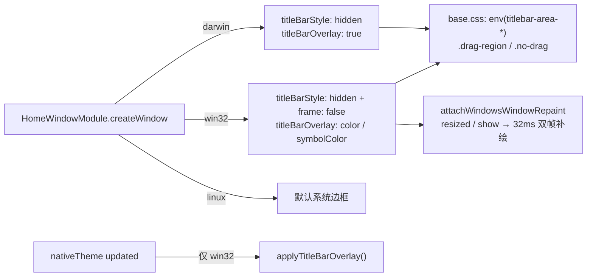

---

title: 原生窗口体验（WCO）
description: 采用 Window Controls Overlay，保留 Win11 贴靠与原生管理，底色同源杜绝白闪与重绘黑边。
---

# 原生窗口体验（WCO）

> **TL;DR**：采用 Window Controls Overlay（WCO）让内容延伸至标题栏同时保留系统窗口管理能力（Win11 贴靠、最大化动画与原生控制按钮）；窗口底色与 Overlay 同源配置杜绝白闪，win32 挂载低频重绘守护消除无边框黑边残影。

- **本页负责**：WCO 跨平台配置分支、窗口底色与 Overlay 同源、拖拽区避让及 win32 重绘守护。
- **本页不负责**：窗口尺寸计算与 `windowStatePersistence` 见 [窗口位置与尺寸](/ui/window-state)；关闭按钮拦截分流见 [首次关闭确认](/ui/close-confirmation) 与 [托盘常驻、单实例与开机自启](/main/tray-single-instance)；`nativeTheme` 运行时主题广播见 [主题链路](/ui/theme-pipeline)。

## 1. 选型理由

传统自定义标题栏往往只配**裸 `frame: false`** 而不启用 `titleBarOverlay`：

1. **系统能力失守**：Windows 11 分屏贴靠（Snap Layouts）、原生窗口阴影与平滑最大化动画全部失效，只能手写易出错的模拟逻辑。
2. **白闪与合成器黑边**：窗口创建瞬间底色未对齐页面会在深色模式下明显白闪，Windows 跨屏拖拽或锁屏唤醒后也容易残留黑边。

本工程采用 **Window Controls Overlay (WCO)**：macOS 只开启 `titleBarStyle: 'hidden'` + `titleBarOverlay: true` 暴露安全区变量，Windows 在 `titleBarStyle: 'hidden'` + `frame: false` 上叠加 `titleBarOverlay` 托管系统控制按钮，Linux 保持系统默认边框。

官方参考：[Electron 窗口定制（Window Controls Overlay）](https://www.electronjs.org/docs/latest/tutorial/window-customization#window-controls-overlay)（读它能查清 `titleBarStyle: 'hidden'`、`titleBarOverlay` 对象/布尔值的跨平台差异，以及 CSS `env(titlebar-area-*)` 安全区环境变量）。

## 2. 核心机制



### 跨平台分流配置

`HomeWindowModule.createWindow` 按当前平台注入构造参数，同时将 `backgroundColor` 与 Overlay 绑定到同一主题解析源：

→ 源码：[packages/main/src/modules/window/home-window.module.ts](https://github.com/BanShan-Alec/electron-react-monorepo-template/blob/main/packages/main/src/modules/window/home-window.module.ts)

```ts
// 节选：createWindow 构造项中的 WCO 平台分支（完整窗口创建与状态持久化见窗口位置页）
const windowOptions = {
  backgroundColor: getWindowBackgroundColor(),
  ...(isMac ? { titleBarStyle: 'hidden', titleBarOverlay: true } : {}),
  ...(isWin
    ? {
        titleBarStyle: 'hidden',
        frame: false,
        titleBarOverlay: getTitleBarOverlayOptions(),
      }
    : {}),
};
```

### 窗口底色与 Overlay 同源防白闪

底色与控制按钮颜色收口在 `titlebar-overlay.ts` 单一真源，直接对齐 Ant Design 容器底色（深色 `#141414` / 浅色 `#ffffff`）；运行时主题切换由 `NativeThemeModule` 调用 `setTitleBarOverlay()` 仅在 win32 同步刷新：

→ 源码：[packages/main/src/modules/window/titlebar-overlay.ts](https://github.com/BanShan-Alec/electron-react-monorepo-template/blob/main/packages/main/src/modules/window/titlebar-overlay.ts)

```ts
// 节选：底色与 Overlay 同源生成（省略 canUpdateTitleBarOverlay）
export function getWindowBackgroundColor(): string {
  return nativeTheme.shouldUseDarkColors ? '#141414' : '#ffffff';
}

export function getTitleBarOverlayOptions(): { color: string; symbolColor: string } {
  const shouldUseDarkColors = nativeTheme.shouldUseDarkColors;
  return {
    color: getWindowBackgroundColor(),
    symbolColor: shouldUseDarkColors ? 'rgba(255, 255, 255, 0.85)' : 'rgba(0, 0, 0, 0.88)',
  };
}
```

## 3. 桌面端避坑注意事项

- **Windows 无边框重绘守护（`attachWindowsWindowRepaint`）**：win32 无边框 WCO 在跨多 DPI 屏幕拖拽、Snap 贴靠或锁屏唤醒后偶发合成器残影；[window-repaint.ts](https://github.com/BanShan-Alec/electron-react-monorepo-template/blob/main/packages/main/src/modules/window/window-repaint.ts) 仅监听低频 `'resized'` 与 `'show'` 事件，立即并延迟 `32ms` 调用 `win.webContents.invalidate()` 补绘双帧（严禁监听高频 `'resize'`）。
- **可拖拽区与子控件避让**：[base.css](https://github.com/BanShan-Alec/electron-react-monorepo-template/blob/main/packages/renderer/src/styles/base.css) 通过 `.drag-region`（`-webkit-app-region: drag`）与 `.no-drag`（`-webkit-app-region: no-drag`）划分拖拽区，并在 `.platform-darwin` / `.platform-win32` 按 `env(titlebar-area-*)` 预留左右安全区；拖拽区内的交互按钮必须带 `.no-drag` 或拆至第二层业务栏。
- **macOS 与 Linux 参数边界**：macOS 传 `titleBarOverlay: true` 仅启用 CSS `env()` 变量，红绿灯外观由系统托管（传 `color` 会被忽略且 `setTitleBarOverlay` 仅限 win32 调用）；Linux 窗口管理器碎片化，保持原生边框不做 WCO 定制。
