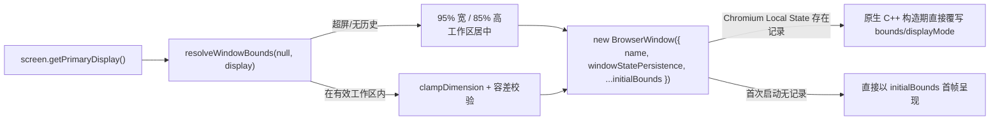

---

title: 窗口位置与尺寸（Window-state）
description: 首次启动自适应工作区居中，拔屏超屏保护回退，续启交由原生 windowStatePersistence 在构造期无感恢复。
---

# 窗口位置与尺寸（Window-state）

> **TL;DR**：首次启动与多屏拔插超屏由纯函数 `resolveWindowBounds` 计算工作区自适应居中几何；再次启动交给 Electron 原生 `windowStatePersistence` 在窗口构造期从 Chromium `Local State` 直接恢复，彻底消灭二次尺寸抖动。

- **本页负责**：主窗口首次启动自适应几何、多屏拔插超屏保护纯函数 `resolveWindowBounds`，以及 `windowStatePersistence` 构造期恢复机制。
- **本页不负责**：窗口几何常量（含更新窗口 `UPDATER_WINDOW_*`）归属见 [配置项归属](/dx/configuration-map)；WCO 标题栏与 win32 重绘守护见 [原生窗口体验（WCO）](/ui/wco)；应用偏好配置存储 `config.json` 见 [配置持久化](/main/config-persistence)。

## 1. 选型理由

传统第三方状态库（如 `electron-window-state`）或自行落盘 `setBounds()` 存在两类顽疾：

1. **二次跳动（Flicker）**：窗口先按默认尺寸创建，随后再由 JS 执行 `setBounds()` 或 `maximize()`，肉眼可见尺寸抖动。
2. **多屏拔插越界**：外接大屏关闭后拔掉显示器，残留坐标落到副屏虚无区域，导致窗口在屏外不可见。

本工程采用「首启与拔屏纯函数保护 + 续启交由原生 `windowStatePersistence` 构造期恢复」的组合方案。

官方参考：[Electron `BrowserWindow` 构造选项](https://www.electronjs.org/docs/latest/api/browser-window#new-browserwindowoptions)（读它能核对 `BrowserWindow` 构造项、`name` / `windowStatePersistence` 原生持久化契约与窗口几何边界）。

## 2. 核心机制



### 纯函数几何裁决与超屏保护（resolveWindowBounds）

`resolveWindowBounds` 在尺寸超屏或缺失时调用 `calculateAdaptiveInitialSize`，在坐标越界时调用 `calculateCenteredCoordinates` 重算居中坐标（极小屏时自动贴左上角以防关闭按钮掉出屏幕）：

→ 源码：[packages/main/src/modules/window/window-size.ts](https://github.com/BanShan-Alec/electron-react-monorepo-template/blob/main/packages/main/src/modules/window/window-size.ts)

```ts
// 节选：resolveWindowBounds 的超屏重置与越界容差居中分支（省略参数签名与类型注解）
const isOversized =
  hasHistorySize && (persisted.width! > workArea.width || persisted.height! > workArea.height);

const { width, height } =
  hasHistorySize && !isOversized
    ? {
        width: clampDimension(persisted.width!, MIN_WINDOW_WIDTH, workArea.width),
        height: clampDimension(persisted.height!, MIN_WINDOW_HEIGHT, workArea.height),
      }
    : calculateAdaptiveInitialSize(workArea);

const isPositionInvalid =
  isOversized ||
  x === undefined ||
  y === undefined ||
  x < workArea.x - POSITION_TOLERANCE_X ||
  x > workArea.x + workArea.width - POSITION_TOLERANCE_X ||
  y < workArea.y - POSITION_TOLERANCE_Y_TOP ||
  y > workArea.y + workArea.height - POSITION_TOLERANCE_Y_BOTTOM;
if (isPositionInvalid) {
  const centered = calculateCenteredCoordinates({ width, height }, workArea);
  x = centered.x;
  y = centered.y;
}
```

自适应尺寸与容差常量统一定义在 `@app/shared/constants/window-geometry`（见 [配置项归属](/dx/configuration-map)），高分屏或小工作区下受 `MAX_WORK_AREA_WIDTH_RATIO`（95%）与 `MAX_WORK_AREA_RATIO`（85%）收缩保护，且不低于 `MIN_WINDOW_WIDTH` / `MIN_WINDOW_HEIGHT`。

### 续启交给官方 windowStatePersistence

→ 源码：[packages/main/src/modules/window/home-window.module.ts](https://github.com/BanShan-Alec/electron-react-monorepo-template/blob/main/packages/main/src/modules/window/home-window.module.ts)

```ts
// 节选：主窗口构造期注入唯一 name 与原生持久化开关
const browserWindow = new BrowserWindow({
  title: app.getName(),
  name: WINDOW_IDS.HOME,
  windowStatePersistence: this.keepState,
  x: initialBounds.x,
  y: initialBounds.y,
  width: initialBounds.width,
  height: initialBounds.height,
  minWidth: MIN_WINDOW_WIDTH,
  minHeight: MIN_WINDOW_HEIGHT,
});
```

Electron 在 C++ 构造阶段从 Chromium `Local State` 读取历史尺寸与最大化状态并覆写构造参数，首帧呈现即为记忆状态。

## 3. 桌面端避坑注意事项

- **严禁在创建窗口后手动补调 `maximize()`**：`windowStatePersistence` 已接管最大化与全屏状态恢复，构造后再次手调会破坏原生恢复时序并产生闪烁。
- **状态保存在 `userData/Local State` 而非 `window-state.json`**：工程不再另行维护独立 JSON 文件；如需重置某窗口的持久几何，可调用 `BrowserWindow.clearPersistedState(WINDOW_IDS.HOME)`。
- **Windows 分数缩放存在上游 1–2px 漂移**：在 Windows 125% / 150% / 175% 非整数 DPI 缩放下，Chromium 底层坐标还原会有 1–2px 微小偏移（上游已知行为），编写 E2E 几何断言时务必保留容差（见 [端到端断言策略](/testing/e2e-assertions)）。
