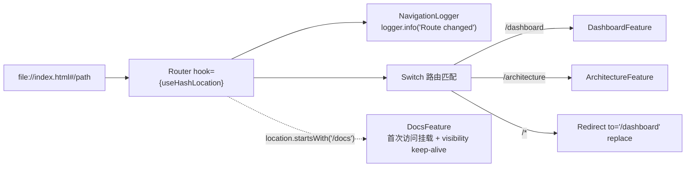

---

title: 路由（Wouter）
description: 采用轻量级 Wouter 驱动，useHashLocation 深度适配本地 file:// 协议。
---

# 路由（Wouter）

> **TL;DR**：采用轻量级 Wouter 替代 React Router；在 Electron 桌面端使用 `useHashLocation`（Hash 路由）适配本地 `file://` 加载协议，未知路径用 `replace` 兜底重定向，路由切换轨迹自动写入系统日志。

- **本页负责**：主窗口前端路由选型（Wouter + `useHashLocation`）、`file://` 协议适配、未知路径 `replace` 兜底及路由切换日志记录。
- **本页不负责**：多窗口物理入口（MPA）拆分见 [多窗口入口](/architecture/multi-window)；功能域内部组件划分见 [功能域组织](/architecture/feature-domains)；文档站 iframe 的离线缓存与 keep-alive 策略见 [文档站离线缓存](/ui/docs-tab-offline)。

## 1. 选型理由

桌面客户端内部的页面切换面临两大特定约束：

1. **本地 `file://` 协议限制**：生产打包态窗口直接加载本地静态 HTML。若采用 Browser History API，页面刷新或深层跳转时因缺乏服务端 rewrite，将直接触发 `ERR_FILE_NOT_FOUND`。Hash 路由（`#/...`）完全在片段内解析，天然适配本地协议。
2. **轻量体积与低侵入**：Wouter 无需侵入式路由配置树，更适合多窗口桌面应用的轻量壳层。

官方参考：[Wouter 文档（自定义 Location Hook）](https://github.com/molefrog/wouter#customizing-the-location-hook)（读它能确认 `useHashLocation` 如何替换默认 History hook，以及 `Switch` / `Route` / `Redirect` 的匹配语义）。

## 2. 核心机制



### 挂载 Hash 路由协议

在主窗口入口根部挂载 `<Router hook={useHashLocation}>`，包住路由切换与全局壳层组件：

→ 源码：[packages/renderer/src/entries/home/index.tsx](https://github.com/BanShan-Alec/electron-react-monorepo-template/blob/main/packages/renderer/src/entries/home/index.tsx)

```tsx
createRoot(document.getElementById('root')!).render(
  <StrictMode>
    <AppProviders>
      <Router hook={useHashLocation}>
        <StartupReadyNotifier />
        <CloseBehaviorDialog />
        <App />
      </Router>
    </AppProviders>
  </StrictMode>,
);
```

### 路由日志与未知路径兜底重定向

`NavigationLogger` 监听 `useLocation()` 变化并落盘记录路由轨迹；主内容区由 `<Switch>` 匹配 `/dashboard` 与 `/architecture`，根路径及未知路径通过 `replace` 重定向到 `/dashboard`。`/docs` 路由在初次访问后保持挂载（`docsMounted`）并用 `invisible` 隐藏，避免切走再切回时重载文档站 iframe：

→ 源码：[packages/renderer/src/entries/home/App.tsx](https://github.com/BanShan-Alec/electron-react-monorepo-template/blob/main/packages/renderer/src/entries/home/App.tsx)

```tsx
// 节选：路由轨迹日志与 Switch 路由表（省略外层布局与 /docs keep-alive 容器）
function NavigationLogger() {
  const [location] = useLocation();
  useEffect(() => {
    logger.info('Route changed', { path: location });
  }, [location]);
  return null;
}

const MainRoutes = () => (
  <Switch>
    <Route path="/dashboard">
      <DashboardFeature />
    </Route>
    <Route path="/architecture">
      <ArchitectureFeature />
    </Route>
    <Route path="/*">
      <Redirect to="/dashboard" replace />
    </Route>
  </Switch>
);
```

## 3. 桌面端避坑注意事项

- **生产打包严禁切回 Browser History API**：切勿在主窗口或多窗口中使用 HTML5 History 路由；一旦在 `file://` 本地路径下触发刷新或路径跳转，Chromium 会报 `ERR_FILE_NOT_FOUND` 导致白屏。
- **未知路径必须带 `replace` 属性**：兜底路由必须写 `<Redirect to="/dashboard" replace />`，防止把非法路径压入 Hash 历史栈导致用户后退时陷入重定向死循环。
- **MPA 辅助窗口不引入主路由树**：更新窗口（Updater）等独立物理窗口拥有各自独立的 HTML 入口（见 [多窗口入口](/architecture/multi-window)），不要把主应用的 Wouter 路由树引到辅助窗口中。
