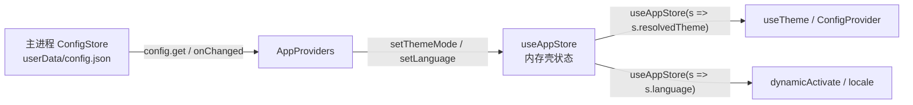

---

title: 全局状态（Zustand）
description: 采用单一无 Provider 的 Zustand Store，主题与语言按需精准订阅。
---

# 全局状态（Zustand）

> **TL;DR**：抛弃冗长的 Redux 与易引发整树重渲染的 React Context，采用单一无 Provider 的 Zustand 管理全局壳层运行态（主题模式、明暗解析、语言模式），组件按字段 selector 细粒度订阅。

- **本页负责**：无 Provider 全局壳状态（`useAppStore`）选型、selector 细粒度订阅约束，以及「壳层状态 vs 业务域 Hook」的分层边界。
- **本页不负责**：`themeMode` 到 `resolvedTheme` 的跨进程解析与首帧同步链路见 [主题链路](/ui/theme-pipeline)；语言偏好 `resolveLocale` 映射见 [国际化](/ui/i18n)；持久化存储见 [配置持久化](/main/config-persistence)；业务域本地状态见 [功能域组织](/architecture/feature-domains) 与 [React 组件编写规范](/architecture/react-conventions)。

## 1. 选型理由

桌面客户端对全局状态管理的核心诉求有三点：

1. **低侵入与零样板**：外层无需再叠一层 `<Context.Provider>`，任意组件或入口脚本都能直接读取状态。
2. **精确按需重渲染**：主题或语言切换时，只有订阅了对应字段的组件重渲，其余业务卡片保持静止。
3. **壳层与业务解耦**：全局 Store 只承接跨全屏壳层属性，业务领域状态完全留在各自 Feature Hook 内。

官方参考：[Zustand 官方文档（Introduction）](https://zustand.docs.pmnd.rs/getting-started/introduction)（读它能掌握无 Provider Store 的创建方式以及基于 selector 切片订阅的渲染优化原理）。

## 2. 核心机制



### 单一 Store 定义（useAppStore）

`useAppStore` 集中维护 `themeMode`、`resolvedTheme` 与 `language`，供 `AppProviders`、`useTheme` 及入口启动脚本订阅与读取：

→ 源码：[packages/renderer/src/stores/useAppStore.ts](https://github.com/BanShan-Alec/electron-react-monorepo-template/blob/main/packages/renderer/src/stores/useAppStore.ts)

```ts
interface AppState {
  themeMode: ThemeMode;
  resolvedTheme: ResolvedTheme;
  setThemeMode: (mode: ThemeMode) => void;
  language: LanguageMode;
  setLanguage: (language: LanguageMode) => void;
}

export const useAppStore = create<AppState>((set) => ({
  themeMode: DEFAULT_THEME_MODE,
  resolvedTheme: resolveTheme(DEFAULT_THEME_MODE),
  setThemeMode: (themeMode) => set({ themeMode, resolvedTheme: resolveTheme(themeMode) }),
  language: DEFAULT_LANGUAGE,
  setLanguage: (language) => set({ language }),
}));
```

### 明暗初始解析（resolveTheme）

Store 内只做纯前端层的同步派生：`'system'` 经 `window.matchMedia(LIGHT_COLOR_SCHEME_QUERY)` 解析为 `'light' | 'dark'`，语言由 `AppProviders` 调 `@app/shared` 的 `resolveLocale` 映射。跨进程广播与 `matchMedia` 监听的完整运行时闭环见 [主题链路](/ui/theme-pipeline)。

→ 源码：[packages/renderer/src/stores/useAppStore.ts](https://github.com/BanShan-Alec/electron-react-monorepo-template/blob/main/packages/renderer/src/stores/useAppStore.ts)

```ts
function resolveTheme(mode: ThemeMode): ResolvedTheme {
  if (mode !== 'system') {
    return mode;
  }
  if (typeof window !== 'undefined' && typeof window.matchMedia === 'function') {
    return window.matchMedia(LIGHT_COLOR_SCHEME_QUERY).matches ? 'light' : 'dark';
  }
  return 'dark';
}
```

## 3. 桌面端避坑注意事项

- **组件严禁解构整个 Store**：错误写法 `const { themeMode } = useAppStore();` 会订阅整个 Store 对象，导致任意无关字段更新触发重渲；必须用精确 selector：`const themeMode = useAppStore((state) => state.themeMode);`。
- **禁止在 Store 中接入 persist 中间件**：Zustand 仅保留在当前渲染进程内存，偏好设置持久化唯一归属主进程 `userData/config.json`，启动拉取与跨窗口同步统一走 `callIpc('config.get')` 与 `window.api.config.onChanged`（见 [主题链路](/ui/theme-pipeline)）。
- **业务领域状态严禁塞入全局 Store**：计数器、计算器、USB 设备列表等状态必须由 `features/<domain>/hooks/` 自行维护（见 [功能域组织](/architecture/feature-domains)），`useAppStore` 只承载跨全屏壳层的基础属性。
